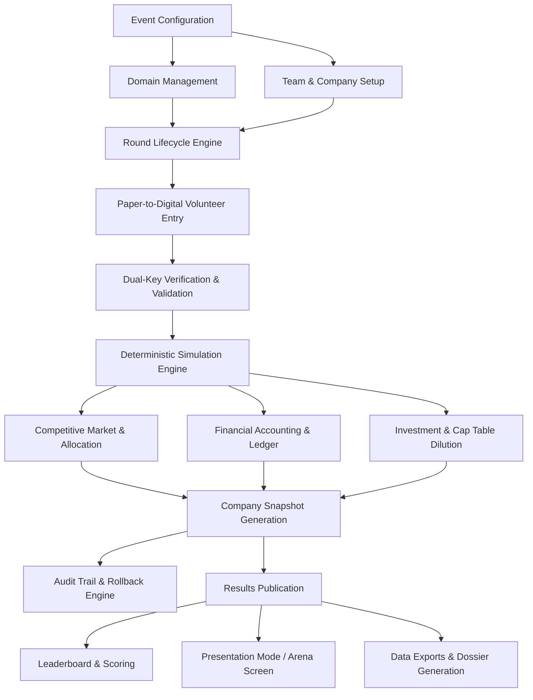

# CAPITAL QUEST — PRODUCT REQUIREMENTS DOCUMENT (PRD)

**Document Reference:** `CQ-SPEC-01`  
**Status:** Implementation-Ready Specification  
**Version:** 1.0.0-PROPOSED  

---

## 1. Executive Summary & Problem Statement

### 1.1 Context
In premier collegiate entrepreneurship competitions, student participants form founding teams to navigate the strategic, operational, and financial trials of building high-growth enterprises. Traditional business simulations frequently suffer from three critical bottlenecks:
1. **Device Friction & Inequality:** Requiring 100+ participants to bring, charge, and connect laptops over congested venue Wi-Fi causes technical disruptions and delays.
2. **Opaque Black-Box Engines:** Students become disengaged when financial or market outcomes appear arbitrary or disconnected from real economic logic.
3. **Operational Bottlenecks for Organizers:** Tabulating complex spreadsheets by hand during live competition windows leads to calculation errors, delayed schedules, and administrative panic.

### 1.2 The Capital Quest Solution
Capital Quest is a **centralized, round-based business simulation platform** featuring an offline-to-online operational model:
- **Physical Deliberation & Paper Submission:** Student teams analyze market dossiers, discuss strategy, and complete standardized physical decision slips.
- **Centralized Volunteer Digitization:** Dedicated volunteers stationed at data entry hubs rapidly digitize decisions using an ultra-responsive, keyboard-optimized interface with dual-key verification.
- **Server-Side Deterministic Simulation:** In less than two seconds, the simulation engine resolves domain-level competitive demand, computes inventory and operational fulfillment, generates double-entry financial ledgers, and updates equity cap tables.
- **Dynamic Arena Presentation:** Results are published to an immersive Presentation Mode, projecting animated market shifts, company performance dossiers, and the final equity-adjusted leaderboard.

---

## 2. Personas & Stakeholders

| Persona | Role in Event | Key Responsibilities & Jobs to Be Done | Tech Comfort | Access Device |
|:---|:---|:---|:---:|:---|
| **Super Admin (Lead Organizer)** | Supreme authority of the competition. | Configures event parameters, controls round states, initiates simulation runs, executes emergency overrides or rollbacks, and triggers presentation reveals. | High | Dedicated organizer laptop (1080p+) |
| **Domain Coordinator / Room Lead** | Floor manager for one of the 4 industry domains. | Manages physical team tables, collects paper decision slips, monitors volunteer queue, and resolves physical submission disputes. | Medium-High | Tablet / Laptop |
| **Volunteer Data Operator** | Event volunteer staff (4–8 people). | Enters paper slip data into the digitization console with maximum speed and accuracy; verifies peer entries. | Moderate | Laptop with numeric keypad (10-key) |
| **Judge / Auditor** | Independent faculty or VC adjudicator. | Inspects audit trails, reviews financial ledger transactions, verifies mathematical fairness, and validates tie-breakers. | Moderate | Laptop or tablet |
| **Participant Observer** | Student founder competing in a team. | Submits paper slips; views domain market announcements, company performance reports, and leaderboard upon publication. | Varied | Mobile device / Arena Projector Display |

---

## 3. Product Scope & Functional Modules

The platform is divided into 15 core functional modules:

---

### Module 1: Event Configuration & Lifecycle Engine
- **Purpose:** Initializes and governs the global competition environment, starting economic parameters, round counts, and system status.
- **Users & Permissions:** Super Admin only.
- **Required Inputs:**
  - Event Name, Description, Slugs.
  - Number of Rounds (Default: 5).
  - Number of Investment Windows (Default: 2; scheduled after Round 2 and Round 4).
  - Initial Starting Operating Capital per team (Default: $1,000,000).
  - Initial Baseline Valuation per team (Default: $200,000).
  - Default Domain Assignment Configuration.
- **Outputs:** Active Event instance, initialized round records (Rounds 1–5), global state record.
- **Business Rules:**
  - Starting operating capital ($1,000,000) and starting valuation ($200,000) are immutable once Round 1 transitions to `OPEN`.
  - Exactly one event can be `ACTIVE` simultaneously per tenant workspace.
- **Validation Rules:**
  - Rounds must be an integer between 3 and 10.
  - Starting capital must be $\ge \$100,000$ and $\le \$10,000,000$.
  - Starting valuation must be $\ge \$50,000$ and $\le \$5,000,000$.
- **Edge Cases:** Emergency event pause, mid-tournament parameter modifications (restricted to unsimulated future rounds).
- **Acceptance Criteria:** Super Admin can spin up a new event within 60 seconds with all 5 rounds and default seed tables initialized.
- **Scope:** MVP includes single active event; multi-event tenancy deferred to Future Scope.

---

### Module 2: Business Domain Management
- **Purpose:** Configures the 4 competitive industry domains with unique economic archetypes, cost structures, and elasticity profiles.
- **Users & Permissions:** Super Admin (Full CRUD); Domain Coordinators (Read).
- **Domains:**
  1. *CleanTech & Hardware:* High unit CapEx, high gross margins, long R&D gestation, lower volume.
  2. *HealthTech & BioDevices:* Stringent quality floor, high regulatory overhead, inelastic demand once accredited.
  3. *Enterprise SaaS & AI:* Negligible unit COGS, high customer acquisition cost (CAC), high R&D requirement, viral retention.
  4. *D2C Consumer Goods:* Fast turnover, high marketing sensitivity, elastic price curve, inventory stockout vulnerability.
- **Required Inputs (per domain):**
  - Name, Code, Description.
  - Base Market Demand (Units/period, e.g., 50,000 units).
  - Benchmark Price ($).
  - Base Unit COGS ($).
  - Demand Price Elasticity ($\epsilon_p$).
  - Quality Sensitivity Weight ($\alpha_q$).
  - Marketing Sensitivity Weight ($\alpha_m$).
- **Outputs:** Domain configuration records mapped to teams.
- **Business Rules:**
  - Teams compete *only* against peers within their assigned domain for that domain's customer pool.
  - Domain parameters cannot be modified for a round after that round is `LOCKED`.
- **Validation Rules:**
  - Elasticity values must be positive floats.
  - Weights must sum to valid scaling ranges.
- **Acceptance Criteria:** Changing domain price benchmark or elasticity alters competitive market share calculations predictably in test runs.
- **Scope:** MVP supports 4 predefined domains with customizable parameters.

---

### Module 3: Team and Company Registration
- **Purpose:** Onboards competing student ventures, assigns unique identifiers, table locations, and domain affiliations.
- **Users & Permissions:** Super Admin (Create, Edit, Delete); Volunteers & Judges (Read).
- **Required Inputs:**
  - Company Legal Name (e.g., "AeroPulse Systems").
  - Team Code / Identifier (e.g., `CT-01`, `CT-02`).
  - Assigned Domain ID.
  - Physical Table / Station Number (e.g., Table 4A).
  - Roster of Student Team Members (Names, Emails, Student IDs).
- **Outputs:** Initialized team profiles, initial Cap Table ($100\%$ team owned), initial financial ledger entries (+$1,000,000 cash credit), and Round 0 Snapshot ($200,000 valuation).
- **Business Rules:**
  - Team Code must be globally unique across the tournament.
  - Each team belongs to exactly one domain throughout the entire tournament.
  - Minimum 3 teams per domain; recommended 5–10 teams per domain (Total: 20–40 teams).
- **Validation Rules:**
  - Company name must be 2–50 characters, sanitized against script injection.
  - Valid table number format.
- **Acceptance Criteria:** Batch CSV import of 40 teams completes in $< 2$ seconds with zero foreign key violations.
- **Scope:** MVP includes manual form registration and CSV batch upload.

---

### Module 4: Volunteer Decision Entry & Digitization
- **Purpose:** Provides a high-speed, ergonomic data entry console for volunteers to transcribe physical paper decision slips into digital records.
- **Users & Permissions:** Volunteers, Super Admin, Domain Coordinators.
- **Required Inputs (per slip):**
  - Round ID & Team Code.
  - Marketing Budget ($).
  - Research & Development (R&D) Budget ($).
  - Production / Inventory Order (Units).
  - Unit Selling Price ($).
  - Operational Efficiency / Quality Budget ($).
  - Investment Selection (Only in Investment Rounds: `OFFER_A`, `OFFER_B`, `REJECT_BOTH`).
- **Outputs:** Unverified / Verified `decisions` record.
- **Business Rules:**
  - Volunteers can enter decisions only while the target round is in `OPEN` state.
  - Each decision slip must record the entering volunteer's user ID and timestamp.
  - Total planned cash outflows cannot exceed the team's available cash reserve at the start of the round.
- **Ergonomic & Validation Rules:**
  - Keyboard-only navigation (Tab / Enter jumps between fields; NumPad friendly).
  - Instant visual feedback on available budget remaining.
  - Real-time hard blocker if `Marketing + R&D + Operations + (Units * UnitCost) > Available Cash`.
- **Acceptance Criteria:** Average volunteer transcription time per slip $\le 18$ seconds with zero required mouse clicks.
- **Scope:** MVP includes single-entry with optional blind dual-key verification mode.

---

### Module 5: Decision Verification, Validation & Approval
- **Purpose:** Guarantees zero data-entry typos by enforcing dual-operator blind entry or rapid peer verification before locking.
- **Users & Permissions:** Volunteers (Peer Verify); Super Admin & Domain Coordinators (Approve / Force Override).
- **Workflow:**
  1. Operator 1 enters slip data $\to$ Record status: `ENTERED`.
  2. Operator 2 (or Coordinator) reviews physical slip against screen or re-enters values $\to$ If matches, status: `VERIFIED`.
  3. If values mismatch $\to$ Visual diff modal triggers; Operator re-inspects physical paper slip.
- **Edge Cases:**
  - *Missing Paper Slip:* Team failed to submit before deadline $\to$ Options: Apply "Default Conservative Policy" (Zero spend, carry over inventory) or "Disqualification".
  - *Illegible Paper Slip:* Volunteer flags slip $\to$ Coordinator summons team representative to physical desk for clarification.
- **Acceptance Criteria:** System prevents simulation execution if any active team has an `UNSUBMITTED` or `MISMATCHED` decision.

---

### Module 6: Financial Accounting & Ledger System
- **Purpose:** Manages financial operations with double-entry principles, maintaining clean distinction between cash flow and accounting profit.
- **Users & Permissions:** System Engine (Automated Write); Super Admin & Judges (Read-Only Audit).
- **Core Entities:** `financial_ledger`, `company_snapshots`.
- **Inputs:** Previous round cash balances, current round expenditures, simulation revenue, COGS, holding costs, investor funding.
- **Outputs:** Comprehensive Income Statement, Balance Sheet, and Cash Flow Statement per team per round.
- **Business Rules:**
  - **Cash Flow vs. Profit Decoupling:**
    - Purchasing inventory consumes liquid cash *immediately* in the round of purchase.
    - Cost of Goods Sold (COGS) is recognized on the Income Statement *only when units are sold*.
    - Unsold inventory remains on the Balance Sheet as a current asset (Current Assets: Cash + Inventory).
  - **No Phantom Capital:** Cash reserves cannot be created from thin air; every cash movement must have a corresponding debit/credit ledger line.
  - **Insolvency Protocol:** If unexpected holding costs or operational overhead push cash $< \$0$, an automatic Emergency Liquidity Facility activates with a punitive $25\%$ round fee and credit penalty.
- **Acceptance Criteria:** Sum of all ledger debits and credits across the tournament reconciles to exactly $\$0.00$ variance.

---

### Module 7: Competitive Market Simulation Engine
- **Purpose:** Resolves multi-party market competition within each domain, allocating customer demand based on relative product quality, marketing visibility, pricing competitiveness, and market events.
- **Users & Permissions:** Super Admin (Initiate Run); System Engine (Execution).
- **Inputs:** Locked decision vectors for all teams in a domain, domain economic parameters, active market event modifiers.
- **Outputs:** Units demanded, units sold, unfulfilled demand, stockout rates, revenue, market share per company.
- **Business Rules:**
  - **Mathematical Determinism:** Execution order of teams has zero impact on allocation.
  - **Luce's Choice Axiom / Multinomial Logit Formulation:** Attractiveness scores $A_i$ determine market share $MS_i = \frac{A_i}{\sum A_j}$.
  - **Fulfillment Constraints:** Units sold cannot exceed available inventory (Beginning Inventory + Production).
  - **Stockout Handling:** Unfulfilled customer demand is partially lost and partially redirected to competitors with available stock.
- **Acceptance Criteria:** Simulating 40 teams across 4 domains completes in $< 1,500\text{ ms}$ with $100\%$ reproducible outputs.

---

### Module 8: Seeded Market Events & Economic Shocks
- **Purpose:** Injects realistic macroeconomic and industry shocks to test team adaptability and strategic resilience.
- **Users & Permissions:** Super Admin (Configure & Preview); System Engine (Apply).
- **Inputs:** Seeded event configurations (Target Domain, Trigger Round, Affected Parameters, Multiplier).
- **Outputs:** Modified market conditions applied dynamically during simulation calculations.
- **Event Types:**
  - *Supply Chain Bottleneck:* Unit production costs $+35\%$; maximum capacity capped at $70\%$.
  - *Viral Industry Adoption / Demand Surge:* Domain total demand $+40\%$; marketing elasticity $+25\%$.
  - *Regulatory Crackdown:* Quality floor raised; teams below quality threshold penalized $50\%$ of demand.
  - *Tech Breakthrough / Patent Cliff:* R&D decay accelerated by $30\%$; quality returns amplified.
  - *Macroeconomic Recession:* Total demand $-25\%$; price elasticity increases (customers become price-sensitive).
- **Business Rules:**
  - Events are deterministic, seeded, and auditable.
  - Event announcements are configured as either **Known in Advance** (revealed on paper briefing at start of round) or **Black Swan Shock** (revealed post-round).
- **Acceptance Criteria:** Event modifiers scale domain variables accurately without corrupting historical baseline parameters.

---

### Module 9: Investment Offers & Equity Dilution Engine
- **Purpose:** Simulates venture capital funding rounds, evaluating offers, calculating post-money valuations, and managing cap table dilution.
- **Users & Permissions:** Super Admin (Configure Offers); Teams (Select via Paper Slip); System (Calculate Dilution).
- **Schedule:** Round 2 (Seed Round) and Round 4 (Series A Growth Round).
- **Inputs:**
  - Offer A: Capital Injection $I_A$, Equity Stake Requested $E_A\%$.
  - Offer B: Capital Injection $I_B$, Equity Stake Requested $E_B\%$.
  - Team Choice: `ACCEPT_A`, `ACCEPT_B`, or `REJECT_BOTH`.
- **Outputs:** Updated `cap_tables`, cash ledger injection, investor equity issuance records.
- **Business Rules:**
  - Maximum of one offer can be accepted per investment round.
  - Accepting an offer dilutes all existing shareholders proportionately:  
    $\text{Team Ownership}_{\text{new}} = \text{Team Ownership}_{\text{old}} \times (1 - E_{\text{investor}}\%)$.
  - Cash is credited immediately to the team's operating cash reserve for subsequent rounds.
  - Rejecting both offers incurs $\$0$ cash and $0\%$ dilution.
- **Acceptance Criteria:** Compounding dilution across multiple rounds maintains $\sum \text{Ownership} = 100.000\%$ precisely.

---

### Module 10: Round Lifecycle Management
- **Purpose:** Enforces an unbreachable sequential progression of rounds to preserve competition integrity.
- **Lifecycle States:**
  $$\text{DRAFT} \longrightarrow \text{OPEN} \longrightarrow \text{LOCKED} \longrightarrow \text{SIMULATED} \longrightarrow \text{REVIEWED} \longrightarrow \text{PUBLISHED}$$
- **State Controls:**
  - `DRAFT`: Round created, parameters editable, volunteer entry disabled.
  - `OPEN`: Decisions being accepted and entered by volunteers.
  - `LOCKED`: Entry frozen; no modifications allowed without Admin Unlock.
  - `SIMULATED`: Engine has executed; results stored in provisional staging.
  - `REVIEWED`: Super Admin and Judges inspect provisional results; sanity checks confirmed.
  - `PUBLISHED`: Official results released to public leaderboard, presentation view, and team dossiers.
- **Rollback Protocol:** Super Admin can roll back a published or simulated round to `LOCKED` or `OPEN`. The engine executes an atomic cascade deletion of all ledger entries and snapshots for that round, restoring the database to the exact pre-simulation state.

---

### Module 11: Company Performance Dossiers & Analytics
- **Purpose:** Generates comprehensive financial and strategic performance reports for each team at the conclusion of every round.
- **Users & Permissions:** Teams, Judges, Admins.
- **Contents:**
  - Executive KPI Cards: Cash Reserves, Current Valuation, Retained Equity %, Current Round Revenue, Net Income, Units Sold.
  - Full Financial Statements: Income Statement, Balance Sheet, Cash Flow Statement.
  - Operational Metrics: Capacity Utilization %, Inventory Waste / Stockout Rate, Unit Margin.
  - Market Standing: Domain Market Share %, Relative Product Quality Index, Brand Equity Score.
  - Visual Charts: Trailing Revenue vs. Net Profit, Cumulative R&D Asset Trajectory, Market Share Radar.
- **Acceptance Criteria:** Team dossier renders smoothly within $300\text{ ms}$, with print-friendly layout for physical distribution if requested.

---

### Module 12: Leaderboard & Final Scoring Engine
- **Purpose:** Computes and ranks companies based on the official tournament scoring formula.
- **Users & Permissions:** Public, Admins, Judges, Presenters.
- **Scoring Formula:**
  $$\mathbf{Final\ Score} = \mathbf{Final\ Company\ Valuation} \times \mathbf{Retained\ Team\ Equity\ Percentage}$$
- **Outputs:**
  - Global Leaderboard (all domains aggregated).
  - Domain Leaderboards (intra-industry standings).
  - Component Breakdown: Valuation, Retained Equity %, Total Cumulative Revenue, Total Net Income.
- **Tie-Breaker Rules (Hierarchical):**
  1. Higher Retained Team Equity Percentage.
  2. Higher Cumulative Tournament Net Profit.
  3. Higher Trailing Round 5 Operating Revenue.
  4. Lower Total Unit Stockout Rate.
- **Acceptance Criteria:** Leaderboard updates instantaneously upon round publication with correct rank ordering and tie-break resolution.

---

### Module 13: Presentation Mode & Stage Reveal
- **Purpose:** Powers the live stage projector display during competition ceremonies, delivering high-impact visual reveals of market movements and leaderboard shifts.
- **Users & Permissions:** Super Admin / AV Presenter.
- **Key Features:**
  - 16:9 Aspect Ratio, High-Contrast Dark Theme optimized for stage projectors.
  - Animated Domain Race: Shows market share migration round-over-round.
  - "Suspense Podium Reveal": Counts down from Rank 10 to Rank 1 with staggered reveal animations.
  - Spotlight Cards: Highlighting "Biggest Pivot", "Top Grossing Venture", "Bootstrap Champion" (highest score without venture funding).
  - Sound Effects / Visual Cues (optional audio triggers for stage drama).
- **Acceptance Criteria:** Presentation mode runs at 60 FPS without layout jitter on standard 1080p and 4K external displays.

---

### Module 14: Audit Logs & Administrative Overrides
- **Purpose:** Maintains a tamper-proof record of every administrative action, data modification, and simulation run.
- **Users & Permissions:** Super Admin & Judges (Inspect); System (Append-Only).
- **Captured Attributes:** Timestamp, User ID, Client IP, Action Type (`CREATE`, `UPDATE`, `LOCK`, `SIMULATE`, `OVERRIDE`, `ROLLBACK`), Entity Name, Entity ID, Full Before/After JSON payload.
- **Acceptance Criteria:** Any change to a decision slip, cap table, or financial ledger entry generates an immutable audit record within the same database transaction.

---

### Module 15: Data Exports & Venue Resilience
- **Purpose:** Enables offline contingency backups and post-event academic analysis.
- **Users & Permissions:** Super Admin & Judges.
- **Formats:**
  - Complete Event Archive (JSON).
  - Volunteer Entry Backup Sheets (CSV).
  - Financial Ledger & Journal Entries (Excel with multi-sheet workbook: P&L, BS, CF, Cap Tables).
  - Printable Round Summary Reports (PDF format for physical bulletin boards).
- **Acceptance Criteria:** Full tournament export of 40 teams across 5 rounds generates in $< 3.5$ seconds.

---

## 4. MVP Scope vs. Future Scope

| Feature / Capability | MVP Scope (College Event Readiness) | Future Scope (Post-Event Roadmap) |
|:---|:---:|:---:|
| **Centralized Volunteer Paper Entry** | Included (Primary Mode) | Optional student mobile entry portal |
| **Deterministic Market Simulation Engine** | Included (4 Domains, Full Math) | Multi-regional cross-domain trade |
| **Cap Table & Investment Dilution** | Included (2 Rounds, 2 Offers each) | Custom investor counter-offers & SAFE notes |
| **Presentation Mode & Projector Reveal** | Included (1080p High Contrast) | 3D WebGL interactive arena graphs |
| **Audit Trails & Atomic Rollback** | Included (Full Transactional) | Blockchain-verified event ledger |
| **CSV / Excel Data Export** | Included | Automated PowerBI / Tableau connectors |
| **Participant Login Accounts** | Deferred (Not Required for Event) | Student team portal with live telemetry |
