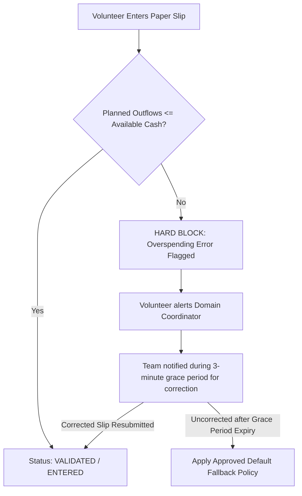
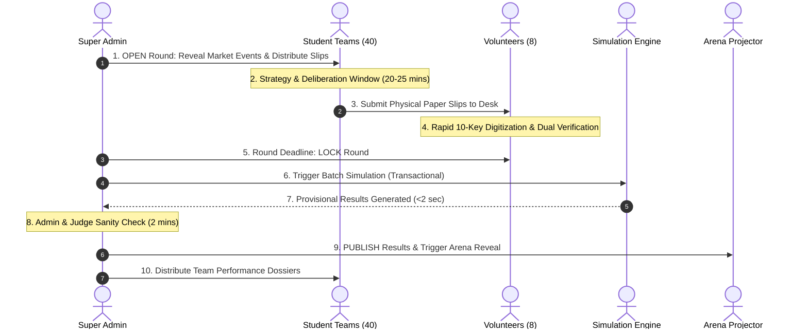

# CAPITAL QUEST — BUSINESS RULES & GAME MECHANICS SPECIFICATION

**Document Reference:** `CQ-SPEC-02`  
**Status:** Implementation-Ready Specification  
**Version:** 1.0.0-PROPOSED  

---

## 1. Game Topology & Structure

### 1.1 Structural Parameters
- **Tournament Scale:** 20 to 40 virtual companies (expandable to 60 upon admin configuration).
- **Competitive Divisions:** Exactly 4 distinct **Business Domains**.
- **Team Distribution:** 5 to 10 companies per domain, ensuring vibrant intra-domain competition without excessive market fragmentation.
- **Operating Timeline:** Exactly **5 Simulation Rounds** representing strategic quarterly or annual fiscal cycles.
- **Financing Windows:** Exactly **2 Strategic Investment Rounds**:
  - *Seed Investment Window:* Concurrently executed with Round 2.
  - *Series A Growth Window:* Concurrently executed with Round 4.
- **Currency Standard:** Virtual United States Dollars (vUSD). All inputs, outputs, and financial statements are denominated in vUSD.

```
+----------------------------------------------------------------------------------------------------+
|                                    TOURNAMENT TIMELINE (5 ROUNDS)                                  |
+----------------------------------------------------------------------------------------------------+
| ROUND 1: Launch & Initial Market Penetration (No Outside Financing)                                |
| ROUND 2: Growth & Scaling + [INVESTMENT WINDOW 1: Seed Capital Round]                             |
| ROUND 3: Mid-Game Execution & Domain Expansion (No Outside Financing)                              |
| ROUND 4: Maturity, Efficiency & Moats + [INVESTMENT WINDOW 2: Series A Round]                     |
| ROUND 5: Final Harvesting & Market Dominance -> FINAL EQUITY-ADJUSTED SCORING                      |
+----------------------------------------------------------------------------------------------------+
```

---

## 2. Business Domain Archetypes & Economic Profiles

Each team is permanently assigned to one of four business domains at event registration. The domains represent distinct economic realities, differing substantially in cost structures, margins, development cycles, and elasticity:

| Parameter | Domain 1: CleanTech & Hardware | Domain 2: HealthTech & BioDevices | Domain 3: Enterprise SaaS & AI | Domain 4: D2C Consumer Goods |
|:---|:---:|:---:|:---:|:---:|
| **Target Market** | Industrial solar, smart grids, grid storage | Medical diagnostic devices, bio-monitors | Enterprise workflow automation, AI agents | Premium sustainable lifestyle products |
| **Base Market Demand ($D_0$)** | 20,000 units / round | 12,000 units / round | 60,000 subscriptions / round | 120,000 units / round |
| **Benchmark Price ($P_{\text{bench}}$)** | $1,200 / unit | $2,500 / unit | $350 / seat / round | $65 / unit |
| **Allowed Price Range** | $800 – $1,800 | $1,600 – $3,800 | $200 – $600 | $40 – $110 |
| **Base Unit COGS ($c_0$)** | $600 / unit | $1,100 / unit | $25 / seat (server hosting/API) | $28 / unit |
| **R&D Sensitivity ($\alpha_{\text{rd}}$)** | High (0.85) | Critical (1.10) | Moderate-High (0.75) | Low-Moderate (0.45) |
| **R&D Carryover / Retention ($\lambda_{\text{rd}}$)** | 70% | 80% | 60% | 50% |
| **Marketing Sensitivity ($\alpha_{\text{mkt}}$)** | Low-Moderate (0.45) | Moderate (0.50) | High (0.85) | Dominant (1.15) |
| **Brand Carryover ($\lambda_{\text{mkt}}$)** | 40% | 50% | 65% | 45% |
| **Price Elasticity ($\epsilon_p$)** | Moderate (1.20) | Inelastic (0.85) | Elastic (1.45) | Highly Elastic (1.80) |
| **Unit Inventory Holding Cost** | $40 / unsold unit | $75 / unsold unit | $0 / seat (virtual capacity) | $4 / unsold unit |
| **Minimum Quality Regulatory Floor** | 30.0 Index Points | 50.0 Index Points | 20.0 Index Points | 15.0 Index Points |

### Archetype Strategic Insights:
- **CleanTech:** High capital requirement. Miscalculating inventory causes severe holding cost penalties. R&D builds long-term defensibility.
- **HealthTech:** Falling below the regulatory quality floor results in severe market penalties or product quarantines. Demands heavy upfront R&D. High gross margins reward quality leaders.
- **Enterprise SaaS & AI:** Zero physical inventory holding cost, but high customer acquisition cost (Marketing) and high pricing elasticity. Rapid customer scaling is vital.
- **D2C Consumer Goods:** Marketing wars dominate. High volume, thin margins. Under-producing leads to devastating stockouts, while over-producing destroys working capital.

---

## 3. Team Decision Parameters & Constraints

In every round, each team submits exactly one **Decision Slip** containing 5 operational inputs (and 1 investment decision during investment rounds):

```
+----------------------------------------------------------------------------------------------------+
|                                    CAPITAL QUEST DECISION SLIP                                     |
+----------------------------------------------------------------------------------------------------+
| Team Code: [ CT-04 ]             Company: [ HelioGrid Dynamics ]              Round: [ 2 ]         |
+----------------------------------------------------------------------------------------------------+
| 1. MARKETING EXPENDITURE (vUSD):                     $ [ 180,000 ]                                 |
| 2. RESEARCH & DEVELOPMENT (R&D) EXPENDITURE (vUSD):  $ [ 220,000 ]                                 |
| 3. INVENTORY PRODUCTION ORDER (Units Ordered):         [   1,200 ] units                           |
| 4. UNIT SELLING PRICE (vUSD / Unit):                 $ [   1,350 ]                                 |
| 5. OPERATIONAL QUALITY & EFFICIENCY BUDGET (vUSD):   $ [  100,000 ]                                 |
+----------------------------------------------------------------------------------------------------+
| [INVESTMENT WINDOW ONLY - ROUND 2 & 4]                                                             |
| Select ONE Option:  [ ] Accept Offer A   [X] Accept Offer B   [ ] Reject Both                      |
+----------------------------------------------------------------------------------------------------+
| Signature of CEO / CFO: _______________________________   Timestamp: 14:22:10                      |
+----------------------------------------------------------------------------------------------------+
```

### 3.1 Field Definitions & Operating Boundaries

1. **Marketing Expenditure ($M_t$):**
   - Directly enhances brand awareness and promotional visibility in the current round.
   - Part of the expenditure compounds into long-term Brand Equity ($\lambda_{\text{mkt}}$ carryover).
   - Constraints: Minimum $\$0$; Maximum: Available Operating Cash.

2. **R&D Expenditure ($R_t$):**
   - Directly funds technology enhancement, feature maturity, and regulatory compliance.
   - Compounds into cumulative Product Quality Index ($Q_t$) with diminishing marginal returns.
   - Constraints: Minimum $\$0$; Maximum: Available Operating Cash.

3. **Inventory Production Order ($U_{\text{prod}, t}$):**
   - Number of physical or virtual units authorized for manufacturing/provisioning this round.
   - Direct Cash Drain = $U_{\text{prod}, t} \times \text{Unit Production Cost}$.
   - Available Units for Sale = Beginning Inventory ($U_{\text{beg}, t}$) + $U_{\text{prod}, t}$.
   - Constraints: Minimum $0$ units; Maximum: $\lfloor \frac{\text{Available Operating Cash}}{\text{Unit Production Cost}} \rfloor$.

4. **Unit Selling Price ($P_t$):**
   - The price customers are charged per unit.
   - Benchmarked against domain norms ($P_{\text{bench}}$). Higher pricing yields higher gross margin per unit sold, but reduces relative attractiveness score $A_i$ based on domain price elasticity.
   - Constraints: Must fall within the Domain Allowed Price Range.

5. **Operational Quality & Efficiency Budget ($O_t$):**
   - Discretionary investment in lean manufacturing, logistics optimization, and quality assurance.
   - Reduces unit production costs for the round (up to a domain maximum discount of $20\%$) and mitigates inventory holding losses and supply chain shock impacts.
   - Constraints: Minimum $\$0$; Maximum: Available Operating Cash.

6. **Investment Choice (Rounds 2 & 4 only):**
   - `OFFER_A`: Accept VC Offer A (Typically higher capital injection, higher equity stake).
   - `OFFER_B`: Accept VC Offer B (Typically moderate capital injection, lower equity stake / founder-friendly).
   - `REJECT_BOTH`: Decline outside venture financing, preserve $100\%$ of existing cap table, receive $\$0$ external cash.

---

## 4. Solvency, Cash Constraints & Overspending Policies

### 4.1 The Fundamental Solvency Constraint
At the moment of decision submission, a team's total planned cash outflow cannot exceed its available liquid operating cash:

$$\text{Planned Outflow}_t = M_t + R_t + O_t + \left(U_{\text{prod}, t} \times c_t\right) \le \text{Cash}_{\text{available}, t}$$

Where:
- $\text{Cash}_{\text{available}, t} = \text{Cash}_{\text{reserve}, t-1}$ (Cash at end of previous round).
- $c_t$ is the effective unit production cost after applying operational efficiency discounts.

### 4.2 Handling Overspending & Paper Slip Discrepancies (P-02 Fix)
Because decisions are submitted on physical paper, teams may occasionally write down numbers whose sum exceeds their available cash. To preserve mathematical fairness and prevent hidden adjustments, the system enforces a strict **Explicit Validation Protocol**:



- **No Silent Auto-Scaling:** The system does **not** silently reduce or rescale marketing, R&D, or production allocations behind the scenes. Any overspending allocation is explicitly rejected at entry time.
- **Volunteer Console Feedback:** The digitization console calculates total planned cash outflow in real time and disables submission if $\text{Planned Outflows} > \text{Available Cash}$.

### 4.3 The Approved Default Fallback Rule
If a team fails to submit a slip within the designated round window (including the 3-minute grace period), submits an illegible slip, or refuses to correct an overspending slip:
1. Selling Price defaults to Domain Benchmark Price ($P_{\text{bench}}$).
2. Production Order is clamped to the minimum baseline affordable units within remaining cash.
3. Marketing, R&D, and Operations discretionary budgets are set to $\$0.00$.
4. Any unexercised investment decision defaults to `REJECT_BOTH`.
5. An administrative delay penalty of $\$10,000$ is deducted from cash reserves.

### 4.4 Insolvency Policy (Emergency Borrowing Disabled in MVP - P-02 Fix)
- **Automatic Emergency Borrowing is DISABLED in MVP:** No phantom credit facilities, automatic loan draws, or arbitrary distress interest rates are applied.
- **Prevention at the Gate:** Because production costs, marketing, R&D, and operations expenses are validated against liquid cash prior to simulation, operational cash deficits cannot occur during standard execution.
- **Inventory Holding Cost Protection:** In the rare event that extreme inventory holding costs on unsold units threaten cash reserves, ending cash is bounded at $\$0.00$ without generating unapproved debt liabilities.

---

## 5. Round Operational Lifecycle Protocol

To guarantee smooth tournament operations across 40 teams, the competition follows a strict clock-driven protocol:



### Step-by-Step State Transition Rules:

1. **State `DRAFT` $\to$ `OPEN`:**
   - Pre-round market news dossier printed or displayed on arena screen.
   - Timer starts (Standard: 25 minutes for deliberation in Rounds 1, 3, 5; 30 minutes in Rounds 2 and 4 to accommodate investment offers).
2. **State `OPEN` $\to$ `LOCKED`:**
   - Physical collection bins closed at timer expiry.
   - Volunteers complete remaining entries in the digitized queue.
   - Admin locks the round. Once locked, no volunteer can edit any record without explicit Admin Unlock.
3. **State `LOCKED` $\to$ `SIMULATED`:**
   - Super Admin clicks "Execute Simulation".
   - Server runs deterministic simulation in an isolated database transaction.
   - Generates provisional snapshots and ledger rows.
4. **State `SIMULATED` $\to$ `REVIEWED`:**
   - Admin and Judges inspect the provisional executive dashboard.
   - Sanity checks verified: No NaN values, total demand accounted for, all balance sheets balanced.
5. **State `REVIEWED` $\to$ `PUBLISHED`:**
   - Results officially locked into permanent history.
   - Leaderboard updates live.
   - Arena presentation mode unlocks the round reveal sequence.

---

## 6. Seeded Market Event System

Market events inject dynamic macroeconomic and industry conditions. To eliminate accusations of arbitrary organizer bias, all market events are **predefined, seeded, and auditable**.

### 6.1 Event Taxonomy & Specifications

| Event ID | Event Name | Target Domain | Trigger Round | Mathematical Impact | Participant Notice |
|:---:|:---|:---:|:---:|:---|:---:|
| `EV-01` | **Government Clean Energy Subsidy** | CleanTech | Round 2 | $+30\%$ Total Domain Demand; $+20\%$ Customer Quality Sensitivity | **Known in Advance** (Printed on Round Briefing) |
| `EV-02` | **Critical Bio-Device Component Shortage** | HealthTech | Round 3 | $+40\%$ Unit Production Costs; Max Production Capacity capped at $65\%$ | **Black Swan Shock** (Disclosed after submission) |
| `EV-03` | **Enterprise AI Security Vulnerability** | SaaS & AI | Round 3 | $-25\%$ Base Demand; Teams with R&D Quality Index $< 40$ lose $50\%$ of sales | **Known in Advance** |
| `EV-04` | **Viral TikTok Influencer Adoption** | D2C Goods | Round 4 | $+50\%$ Total Domain Demand; $+35\%$ Marketing Sensitivity ($\alpha_m$) | **Known in Advance** |
| `EV-05` | **Macroeconomic Credit Crunch & Slowdown** | All Domains | Round 5 | $-20\%$ Total Demand; $+30\%$ Price Elasticity (Customers highly price sensitive) | **Known in Advance** |

### 6.2 Pre-Announced vs. Black Swan Events
- **Pre-Announced Events:** Simulates strategic anticipation. Teams receive details on their Round Briefing Sheet and must adapt their pricing, inventory, and budgeting strategy accordingly.
- **Black Swan Events:** Simulates unpreventable operational crises (e.g., sudden factory supply disruptions). Forces teams to rely on operational reserves, robust margins, and quality buffers. Max 1 Black Swan event per tournament.

---

## 7. Investment Windows & Equity Dilution Rules

Outside venture capital is available exclusively in **Round 2 (Seed Round)** and **Round 4 (Series A Round)**. In each window, all teams in a domain receive the same two standardized offers, structured by the tournament investment committee.

### 7.1 Offer Mechanics & Structure

$$\text{Post-Money Valuation} = \frac{\text{Investment Capital Injection}}{\text{Investor Equity Stake Offered}}$$

$$\text{Implied Pre-Money Valuation} = \text{Post-Money Valuation} - \text{Investment Capital Injection}$$

#### Standard Tournament Offer Matrix:
- **Round 2 (Seed Window):**
  - **Offer A (Aggressive Growth Partner):**
    - Cash Injection: **$\$400,000$** vUSD
    - Equity Stake: **$25.0\%$** post-money
    - Implied Post-Money Valuation: $\frac{\$400,000}{0.25} = \$1,600,000$ (Implied Pre-Money: $\$1,200,000$)
  - **Offer B (Founder-Friendly Boutique VC):**
    - Cash Injection: **$\$200,000$** vUSD
    - Equity Stake: **$12.5\%$** post-money
    - Implied Post-Money Valuation: $\frac{\$200,000}{0.125} = \$1,600,000$ (Implied Pre-Money: $\$1,400,000$)
  - **Option C:** `REJECT_BOTH` ($\$0$ cash, $0\%$ equity given up).

- **Round 4 (Series A Window):**
  - **Offer A (Global Tier-1 VC):**
    - Cash Injection: **$\$800,000$** vUSD
    - Equity Stake: **$20.0\%$** post-money
    - Implied Post-Money Valuation: $\frac{\$800,000}{0.20} = \$4,000,000$ (Implied Pre-Money: $\$3,200,000$)
  - **Offer B (Strategic Corporate Partner):**
    - Cash Injection: **$\$450,000$** vUSD
    - Equity Stake: **$10.0\%$** post-money
    - Implied Post-Money Valuation: $\frac{\$450,000}{0.10} = \$4,500,000$ (Implied Pre-Money: $\$4,050,000$)
  - **Option C:** `REJECT_BOTH` ($\$0$ cash, $0\%$ equity given up).

### 7.2 Compounding Cap Table Dilution Formula
When a team accepts investment in multiple rounds, existing ownership is diluted proportionally:

$$\text{Team Ownership}_t = \text{Team Ownership}_{t-1} \times \left(1 - \text{New Investor Equity Stake}\right)$$

#### Proof of Compounding Dilution (Example: Team Accepts Offer A in R2 and Offer A in R4):
1. **Initial (Round 0 & 1):** Team Ownership = $100.00\%$.
2. **After Round 2 (Seed Offer A: $25\%$):**
   - New Investor 1 Ownership = $25.00\%$.
   - Team Retained Ownership = $100.00\% \times (1 - 0.25) = \mathbf{75.00\%}$.
   - Check: $75.00\% + 25.00\% = 100.00\%$.
3. **After Round 4 (Series A Offer A: $20\%$):**
   - New Investor 2 takes $20.00\%$ of total post-money equity.
   - Existing shareholders are diluted by $(1 - 0.20) = 0.80$:
   - Investor 1 Diluted Share = $25.00\% \times 0.80 = 16.00\%$.
   - Team Diluted Share = $75.00\% \times 0.80 = \mathbf{60.00\%}$.
   - Check: $60.00\% \text{ (Team)} + 16.00\% \text{ (Seed VC)} + 20.00\% \text{ (Series A VC)} = \mathbf{100.00\%}$.

### 7.3 Strategic Trade-Off in Capital Quest
Because Final Score is:
$$\text{Final Score} = \text{Final Company Valuation} \times \text{Retained Team Ownership}$$
Taking venture capital gives a team massive liquid cash to spend on R&D, aggressive marketing, and large production runs (driving up Company Valuation), but costs them $20\%\text{ to }40\%$ of their ultimate equity payout! Teams must strategically decide whether the capital will generate enough valuation growth to compensate for the equity dilution.
