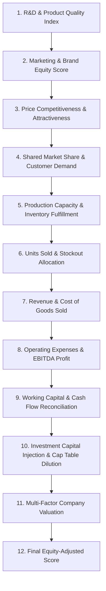

# CAPITAL QUEST — FINANCIAL FORMULA & MATHEMATICAL ENGINE SPECIFICATION

**Document Reference:** `CQ-SPEC-03`  
**Status:** Implementation-Ready Specification  
**Version:** 1.0.0-PROPOSED  

---

## 1. Resolution of the Starting Capital vs. Starting Valuation Paradox

### 1.1 The Fundamental Economic Conflict
A critical paradox exists in the baseline competition rules:
> *"Every team begins with $1,000,000 in virtual operating capital."*  
> *"Every company has an initial game-defined valuation of $200,000."*

In standard corporate finance and GAAP/IFRS accounting:
$$\text{Balance Sheet Equity} = \text{Assets} - \text{Liabilities}$$
If a company holds $\$1,000,000$ in unencumbered, liquid cash with zero debt, its book value of equity is $\$1,000,000$. Assigning a market valuation of $\$200,000$ creates an irrational economic scenario:
$$\text{Enterprise Value (EV)} = \text{Market Valuation} - \text{Cash} = \$200,000 - \$1,000,000 = -\$800,000$$
A negative enterprise value of $-\$800,000$ implies that investors view the company's future operations as so destructive to capital that its business operations have negative worth, or that $\$800,000$ of cash is inaccessible.

Furthermore, if the final valuation formula were simply:
$$\text{Valuation} = \text{Revenue Multiple} + \text{Remaining Cash}$$
A passive team could spend $\$0$ across all 5 rounds, retain their $\$1,000,000$ cash, and finish with a valuation higher than an ambitious team that invested $\$800,000$ into R&D and factories to build a $\$900,000$ enterprise. This creates a severe **"Capital Hoarding Dominant Strategy"** that ruins student engagement.

---

### 1.2 Proposed Resolution: The Incubator Operating Grant & Enterprise Multiplier Model

To create a coherent, beginner-friendly, and mathematically robust model, Capital Quest adopts the **"Restricted Incubation Treasury & Calibrated Enterprise Valuation"** model:

```
+----------------------------------------------------------------------------------------------------+
|                                    STARTING ASSET & VALUATION STRUCTURE                            |
+----------------------------------------------------------------------------------------------------+
| 1. STARTING OPERATING CAPITAL: $1,000,000                                                          |
|    - Classification: Restricted Institutional Incubation Treasury (Non-Liquidatable Seed Grant).    |
|    - Purpose: Fully deployable for operating expenses (R&D, Marketing, Production, Quality).        |
|    - Balance Sheet Treatment: Operating Working Capital Asset (Restricted Cash).                   |
|                                                                                                    |
| 2. INITIAL VALUATION: $200,000                                                                     |
|    - Classification: Pre-Revenue Intellectual Property & Benchmark Enterprise Value (EV_0).        |
|    - Represents: The baseline appraised value of the founding team's prototype, domain license,     |
|      and core intellectual property before commercial revenue is unlocked.                         |
+----------------------------------------------------------------------------------------------------+
```

#### How Cash Factors into Company Valuation
To prevent capital hoarding while properly rewarding disciplined cash management:
1. **Operating Enterprise Value ($EV_t$):** Driven purely by business execution: trailing revenue, operating profit (EBITDA), capitalized R&D quality assets, and domain market share.
2. **Cash Capital Contribution ($V_{\text{cash}, t}$):**
   - Unspent cash does **not** contribute dollar-for-dollar to market valuation. Instead, cash held above a healthy working capital reserve is valued at a calibrated multiplier ($\omega_{\text{cash}} = 0.25$).
   - Cash spent on productive R&D, brand equity, and efficient manufacturing generates significantly higher multiples of enterprise value ($1.5\times\text{ to }3.5\times$) than unspent cash.
   - At Round 0: Revenue $= \$0$, EBITDA $= \$0$, R&D $= \$0$, and Cash Contribution $= \$0$. Thus:
     $$\mathbf{Valuation}_0 = \mathbf{EV}_0 = \mathbf{\$200,000.00}$$
   - This cleanly preserves the initial $\$200,000$ valuation rule while providing $\$1,000,000$ in full operating liquidity.

---

## 2. Comprehensive Formula Architecture & Execution Pipeline

The simulation engine calculates outcomes for all companies in a domain strictly according to this ordered 12-stage pipeline:



---

### Step 1: R&D Accumulation & Product Quality Index

R&D investments produce tangible product improvements that compound over time, subject to technological obsolescence and diminishing marginal returns.

#### Formulas:
1. **Effective Cumulative R&D Stock ($K_{\text{rd}, i, t}$):**
   $$K_{\text{rd}, i, t} = R_{i, t} + \left(\lambda_{\text{rd}} \times K_{\text{rd}, i, t-1}\right)$$
   - $R_{i, t}$: Current round R&D expenditure (vUSD).
   - $\lambda_{\text{rd}}$: Domain R&D retention rate (e.g., $0.70$ in CleanTech, $0.80$ in HealthTech).
   - $K_{\text{rd}, i, 0} = \$0$.

2. **Product Quality Index ($Q_{i, t}$):**
   $$Q_{i, t} = Q_{\text{base}} + \left(Q_{\text{max}} - Q_{\text{base}}\right) \times \left(1 - e^{-\gamma_{\text{rd}} \times K_{\text{rd}, i, t}}\right)$$
   - $Q_{\text{base}}$: Baseline product quality (e.g., $20.0$ points).
   - $Q_{\text{max}}$: Asymptotic quality ceiling (e.g., $100.0$ points).
   - $\gamma_{\text{rd}}$: Domain scaling coefficient ($1.5 \times 10^{-6}$).
   - Units: Quality Index Points ($[0.0, 100.0]$).
   - Rounding: 2 decimal places.

---

### Step 2: Marketing Expenditure & Cumulative Brand Equity

Marketing creates immediate consumer buzz while building persistent brand equity that decays if not maintained.

#### Formulas:
1. **Cumulative Brand Equity Stock ($B_{i, t}$):**
   $$B_{i, t} = M_{i, t} + \left(\lambda_{\text{mkt}} \times B_{i, t-1}\right)$$
   - $M_{i, t}$: Current round marketing expenditure (vUSD).
   - $\lambda_{\text{mkt}}$: Domain brand retention factor (e.g., $0.45$ in D2C, $0.65$ in SaaS).
   - $B_{i, 0} = \$0$.

2. **Normalized Brand Attractiveness Ratio ($\beta_{i, t}$):**
   $$\beta_{i, t} = \frac{B_{i, t} + \epsilon_{\text{floor}}}{\bar{B}_t + \epsilon_{\text{floor}}}$$
   - $\bar{B}_t$: Average brand stock across all competitors in the domain.
   - $\epsilon_{\text{floor}}$: Smoothing constant ($\$1,000$) to avoid division by zero.
   - Notice: $\beta_{i, t}$ is the linear relative brand equity ratio. The domain marketing sensitivity exponent $\alpha_{\text{mkt}}$ is applied exactly once in Step 4 below ($\beta_{i, t}^{\alpha_m}$), eliminating double exponentiation.

---

### Step 3: Relative Price Competitiveness

Price sensitivity is modeled relative to the Domain Benchmark Price ($P_{\text{bench}}$). Setting a price above benchmark reduces attractiveness; setting it below benchmark increases attractiveness.

#### Formula:
$$\pi_{i, t} = \left(\frac{P_{\text{bench}}}{P_{i, t}}\right)^{\epsilon_p}$$
- $P_{i, t}$: Company $i$'s unit price set on the decision slip.
- $P_{\text{bench}}$: Domain benchmark standard price.
- $\epsilon_p$: Domain price elasticity exponent ($0.85\text{ in HealthTech to }1.80\text{ in D2C}$).

---

### Step 4: Company Attractiveness & Competitive Market Share

Market share is allocated using **Luce's Choice Axiom (Multinomial Logit Formulation)**. Each company generates an overall Attractiveness Score ($A_{i, t}$); its market share is its proportional share of total domain attractiveness.

#### Formulas:
1. **Raw Attractiveness Score ($A_{i, t}$):**
   $$A_{i, t} = \left(Q_{i, t}^{\alpha_q}\right) \times \left(\beta_{i, t}^{\alpha_m}\right) \times \left(\pi_{i, t}\right) \times \Phi_{\text{event}, i, t}$$
   - $\alpha_q$: Domain quality weighting exponent.
   - $\alpha_m$: Domain brand weighting exponent.
   - $\Phi_{\text{event}, i, t}$: Multiplier from active seeded market events (Default: $1.0$).
   - Constraint: If company fails domain regulatory quality floor ($Q_{i, t} < Q_{\text{floor}}$), $A_{i, t}$ is penalized by $50\%$.

2. **Domain Competitive Market Share ($MS_{i, t}$):**
   $$MS_{i, t} = \frac{A_{i, t}}{\sum_{j=1}^{N} A_{j, t}}$$
   - Where $N$ is the total number of companies competing in that specific domain.
   - Mathematical Property: $\sum_{i=1}^{N} MS_{i, t} \equiv 1.000000$ ($100\%$ strictly conserved).

---

### Step 5: Domain Total Demand & Potential Company Demand

#### Formulas:
1. **Total Domain Demand ($D_{\text{domain}, t}$):**
   $$D_{\text{domain}, t} = D_0 \times \left(1 + \Psi_{\text{macro}, t}\right) \times \left(\frac{P_{\text{bench}}}{\bar{P}_t}\right)^{\mu_{\text{domain}}}$$
   - $D_0$: Base domain customer demand.
   - $\Psi_{\text{macro}, t}$: Macro/event demand shock multiplier (e.g., $+0.30$ for subsidy, $-0.20$ for recession).
   - $\bar{P}_t$: Weighted average market price charged by all competitors.
   - $\mu_{\text{domain}}$: Macro domain price sensitivity ($0.50$).

2. **Potential Demand for Company $i$ ($d_{i, t}$):**
   $$d_{i, t} = \left\lfloor D_{\text{domain}, t} \times MS_{i, t} \right\rfloor$$
   - Units: Customer units demanded.

---

### Step 6: Inventory Availability, Fulfillment & Stockouts

A company can only sell units that it has in stock.

#### Formulas:
1. **Available Units for Sale ($U_{\text{avail}, i, t}$):**
   $$U_{\text{avail}, i, t} = U_{\text{beg}, i, t} + U_{\text{prod}, i, t}$$
   - $U_{\text{beg}, i, t}$: Units remaining unsold from round $t-1$ (Beginning Inventory).
   - $U_{\text{prod}, i, t}$: New units manufactured in round $t$.

2. **Units Sold ($U_{\text{sold}, i, t}$):**
   $$U_{\text{sold}, i, t} = \min\left(d_{i, t}, U_{\text{avail}, i, t}\right)$$

3. **Stockout Units (Unfulfilled Demand, $U_{\text{stockout}, i, t}$):**
   $$U_{\text{stockout}, i, t} = \max\left(0, d_{i, t} - U_{\text{avail}, i, t}\right)$$

4. **Ending Inventory ($U_{\text{end}, i, t}$):**
   $$U_{\text{end}, i, t} = U_{\text{avail}, i, t} - U_{\text{sold}, i, t}$$

5. **Redistribution of Unfulfilled Demand:**
   - In competitive markets, when a leading firm stocks out, a portion of its frustrated customers seek alternatives:
     $$D_{\text{redistributed}} = \sum_{j \in \text{Stockouts}} \left(U_{\text{stockout}, j, t} \times \theta_{\text{recapture}}\right)$$
   - $\theta_{\text{recapture}} = 0.40$ ($40\%$ of stockout customers buy from competitors with surplus inventory, allocated pro-rata based on relative attractiveness).
   - $60\%$ of stockout customers abandon the market entirely.

---

### Step 7: Revenue & Cost of Goods Sold (COGS)

To ensure strict financial rigor, inventory costs are recognized on an **Average Cost basis**:

#### Formulas:
1. **Gross Operating Revenue ($\text{Rev}_{i, t}$):**
   $$\text{Rev}_{i, t} = U_{\text{sold}, i, t} \times P_{i, t}$$

2. **Effective Unit Production Cost ($c_{i, t}$):**
   $$c_{i, t} = c_0 \times \left(1 - \min\left(0.20, \frac{O_{i, t}}{\$250,000} \times 0.20\right)\right) \times \Omega_{\text{shock}, t}$$
   - $c_0$: Base unit manufacturing cost.
   - $O_{i, t}$: Operations & Efficiency budget (provides up to $20\%$ cost reduction).
   - $\Omega_{\text{shock}, t}$: Supply chain cost multiplier from market events (e.g., $1.40$ during shortages).

3. **Cost of Goods Sold ($\text{COGS}_{i, t}$):**
   $$\text{COGS}_{i, t} = U_{\text{sold}, i, t} \times c_{\text{avg}, i, t}$$
   - Where $c_{\text{avg}, i, t} = \frac{(U_{\text{beg}} \times c_{\text{prior}}) + (U_{\text{prod}} \times c_{\text{curr}})}{U_{\text{avail}}}$.

4. **Gross Profit ($\text{GP}_{i, t}$):**
   $$\text{GP}_{i, t} = \text{Rev}_{i, t} - \text{COGS}_{i, t}$$

---

### Step 8: Operating Expenses & Operating Profit (EBITDA)

#### Formulas:
1. **Inventory Holding Cost ($H_{i, t}$):**
   $$H_{i, t} = U_{\text{end}, i, t} \times h_{\text{domain}}$$
   - $h_{\text{domain}}$: Unit warehousing and obsolescence cost per round ($4\text{ to }75$ vUSD).

2. **Total Operating Expenses ($\text{OpEx}_{i, t}$):**
   $$\text{OpEx}_{i, t} = M_{i, t} + R_{i, t} + O_{i, t} + H_{i, t} + \text{AdminFee}_{i, t}$$

3. **Operating Profit / EBITDA ($\text{EBITDA}_{i, t}$):**
   $$\text{EBITDA}_{i, t} = \text{GP}_{i, t} - \text{OpEx}_{i, t} = \text{Rev}_{i, t} - \text{COGS}_{i, t} - \text{OpEx}_{i, t}$$

4. **Corporate Taxes ($\text{Tax}_{i, t}$):**
   $$\text{Tax}_{i, t} = \max\left(0, \text{EBITDA}_{i, t} \times \tau_{\text{rate}}\right)$$
   - Tax rate $\tau_{\text{rate}} = 20\%$. Unprofitable rounds generate tax loss carryforwards ($\text{NOL}$).

5. **Net Income / Net Accounting Profit ($\text{NI}_{i, t}$):**
   $$\text{NI}_{i, t} = \text{EBITDA}_{i, t} - \text{Tax}_{i, t}$$

---

### Step 9: Cash Flow Reconciliation (Decoupling Cash from Profit)

A major failure mode in student business simulations is confusing Net Accounting Income with Cash Flow.

#### The Fundamental Reconciliation Identity:
$$\mathbf{Cash}_{i, t} = \mathbf{Cash}_{i, t-1} + \mathbf{Operating\ Cash\ Flow}_{i, t} + \mathbf{Financing\ Cash\ Flow}_{i, t}$$

#### Formulas:
1. **Operating Cash Outflows Incurred in Round $t$:**
   $$\text{Cash Outflows}_{i, t} = M_{i, t} + R_{i, t} + O_{i, t} + \left(U_{\text{prod}, i, t} \times c_{i, t}\right) + H_{i, t} + \text{Tax}_{i, t}$$
   *(Notice: The entire manufacturing cost of units produced this round is paid in cash immediately upon production, NOT when sold).*

2. **Operating Cash Inflows Incurred in Round $t$:**
   $$\text{Cash Inflows}_{i, t} = \text{Rev}_{i, t}$$
   *(Cash from customer sales).*

3. **Operating Cash Flow ($\text{OCF}_{i, t}$):**
   $$\text{OCF}_{i, t} = \text{Cash Inflows}_{i, t} - \text{Cash Outflows}_{i, t}$$
   $$\text{OCF}_{i, t} \equiv \text{NI}_{i, t} - \Delta\text{Inventory Value}_{i, t}$$

4. **Financing Cash Flow ($\text{FCF}_{i, t}$):**
   $$\text{FCF}_{i, t} = I_{\text{investor}, i, t} - \text{Penalty}_{i, t}$$
   - $I_{\text{investor}}$: Outside venture capital injected during Investment Rounds ($0$, $\$200\text{k}$, $\$400\text{k}$, etc.).

5. **Ending Liquid Cash Reserve ($\text{Cash}_{i, t}$):**
   $$\text{Cash}_{i, t} = \text{Cash}_{i, t-1} + \text{OCF}_{i, t} + \text{FCF}_{i, t}$$

---

### Step 10: Multi-Factor Company Valuation Engine

Company valuation in Capital Quest reflects institutional private equity and venture capital valuation principles, combining trailing revenue multiples, operating profitability, capitalized intellectual property (R&D), and unencumbered cash.

#### Formula:
$$\mathbf{Valuation}_{i, t} = \mathbf{EV}_{i, t} + \mathbf{V}_{\text{cash}, i, t}$$

Where:
1. **Enterprise Value ($\mathbf{EV}_{i, t}$):**
   $$\mathbf{EV}_{i, t} = \mathbf{EV}_0 + \left(w_{\text{rev}} \times \text{Rev}_{i, t}\right) + \left(w_{\text{ebit}} \times \max\left(0, \text{EBITDA}_{i, t}\right)\right) + \left(w_{\text{rd}} \times K_{\text{rd}, i, t}\right) + \left(w_{\text{ms}} \times MS_{i, t} \times \$1,000,000\right)$$
   - $\mathbf{EV}_0$: Base Seed Valuation = **$\$200,000.00$**.
   - $w_{\text{rev}}$: Revenue Multiple = $1.8\times$ (CleanTech/HealthTech), $2.5\times$ (SaaS), $1.2\times$ (D2C).
   - $w_{\text{ebit}}$: Profitability Multiple = $3.5\times$ applied to positive operating profit.
   - $w_{\text{rd}}$: IP Capitalization Multiple = $0.40$ (converting cumulative R&D asset value into firm equity).
   - $w_{\text{ms}}$: Domain Market Leadership Premium = $0.50$ (up to $\$500,000$ for commanding market share).

2. **Cash Capital Contribution ($\mathbf{V}_{\text{cash}, i, t}$):**
   $$\mathbf{V}_{\text{cash}, i, t} = \begin{cases} \$0.00, & \text{if } t = 0 \\ \omega_{\text{cash}} \times \max\left(0, \text{Cash}_{i, t} - \text{WC}_{\text{floor}}\right), & \text{if } t \ge 1 \end{cases}$$
   - $\omega_{\text{cash}} = 0.25$ (Each dollar of surplus cash adds $\$0.25$ to firm valuation, ensuring that spending cash on high-multiple R&D and revenue growth is $4\times\text{ to }10\times$ more rewarding than cash hoarding).
   - $\text{WC}_{\text{floor}} = \$250,000$ (Working capital baseline required to operate).
   - **MANDATORY INVARIANT & REGRESSION TEST REQUIREMENT (F-01 Fix):** At Round 0, cash capital contribution $\mathbf{V}_{\text{cash}, i, 0} \equiv \$0.00$ strictly. Therefore, $\mathbf{Valuation}_0 \equiv \mathbf{EV}_0 \equiv \$200,000.00$ for all companies regardless of initial liquid cash reserves. An automated regression test must verify that Round 0 valuation is bit-for-bit equal to $\$200,000.00$.

3. **Valuation Floor & Ceiling Constraints:**
   - **Absolute Valuation Floor:** $\mathbf{Valuation}_{i, t} \ge \$50,000.00$ (Liquidation/salvage value).
   - **Emergency Liquidity Status (P-02 Fix):** Automatic emergency borrowing and distress valuation penalties are **DISABLED in MVP**. Overspending allocations exceeding available cash are rejected at submission time. No silent borrowing or distress haircut is applied without organizer approval.

---

### Step 11: Final Score Formulation

At the conclusion of Round 5, final rankings are determined strictly by:

$$\mathbf{Final\ Tournament\ Score}_i = \mathbf{Valuation}_{i, 5} \times \mathbf{Retained\ Team\ Ownership\ Percentage}_{i, 5}$$

- **Valuation Unit:** vUSD.
- **Retained Ownership Unit:** Ratio in range $[0.0000, 1.0000]$.
- **Final Score Unit:** Score Points (equivalent to Equity-Adjusted Value).
- **Rounding:** Final Score is rounded to the nearest integer.

---

## 3. Worked Numerical Walkthrough (Comparative Company Trajectories)

To prove that the mathematical formulas produce realistic, well-behaved economic outcomes across diverse strategies, we analyze three distinct companies competing in **Domain 1 (CleanTech)** across all 5 rounds.

### Strategy Profiles:
- **Company A ("Hyper-Growth VC Funded"):** Heavy upfront R&D, aggressive marketing, takes Offer A in Round 2 ($+\$400\text{k}$ for $25\%$) and Offer B in Round 4 ($+\$450\text{k}$ for $10\%$).
- **Company B ("Bootstrapped Quality Champion"):** Disciplined self-funded growth, zero venture financing ($100\%$ equity retained), steady R&D, premium pricing.
- **Company C ("Passive Cash Hoarder"):** Minimal spending, hoarding initial $\$1,000,000$ cash, zero outside funding.

---

### Round 1 Detailed Step-by-Step Resolution

- **Domain Benchmark:** $D_0 = 20,000\text{ units}$, $P_{\text{bench}} = \$1,200$, Base COGS $c_0 = \$600$.
- **Starting Cash:** $\$1,000,000$ for all three.

#### Company Inputs (Round 1):
- **Co A:** $M_1 = \$250,000$, $R_1 = \$250,000$, $U_{\text{prod}} = 700\text{ units}$, $P = \$1,200$, $O_1 = \$50,000$.
- **Co B:** $M_1 = \$100,000$, $R_1 = \$150,000$, $U_{\text{prod}} = 500\text{ units}$, $P = \$1,300$, $O_1 = \$50,000$.
- **Co C:** $M_1 = \$10,000$, $R_1 = \$10,000$, $U_{\text{prod}} = 100\text{ units}$, $P = \$1,200$, $O_1 = \$0$.

#### Calculations:
1. **Production Cost:**
   - Co A & B invest $\$50,000$ in Operations $\to 4\%$ cost discount $\to c_1 = \$576 / \text{unit}$.
   - Co C invests $\$0 \to c_1 = \$600 / \text{unit}$.
   - Production Outflows:
     - Co A: $700 \times \$576 = \$403,200$.
     - Co B: $500 \times \$576 = \$288,000$.
     - Co C: $100 \times \$600 = \$60,000$.
   - Total Planned Outflows:
     - Co A: $\$250\text{k} + \$250\text{k} + \$50\text{k} + \$403.2\text{k} = \mathbf{\$953,200} \le \$1,000,000$ (Valid).
     - Co B: $\$100\text{k} + \$150\text{k} + \$50\text{k} + \$288\text{k} = \mathbf{\$588,000} \le \$1,000,000$ (Valid).
     - Co C: $\$10\text{k} + \$10\text{k} + \$0 + \$60\text{k} = \mathbf{\$80,000} \le \$1,000,000$ (Valid).

2. **Quality & Brand:**
   - Co A: $K_{\text{rd}} = \$250\text{k} \to Q = 45.02\text{ pts}$; Brand $B = \$250\text{k}$.
   - Co B: $K_{\text{rd}} = \$150\text{k} \to Q = 36.12\text{ pts}$; Brand $B = \$100\text{k}$.
   - Co C: $K_{\text{rd}} = \$10\text{k} \to Q = 21.19\text{ pts}$ (fails $Q_{\text{floor}} = 30.0$ threshold); Brand $B = \$10\text{k}$.

3. **Attractiveness & Market Share (Single Exponentiation):**
   - Relative Attractiveness Scores:
     - Co A: $Q_A^{0.85} (25.432) \times \beta_A^{0.45} (1.389) \times \pi_A (1.000) = \mathbf{35.318}$
     - Co B: $Q_B^{0.85} (21.077) \times \beta_B^{0.45} (0.922) \times \pi_B (0.909) = \mathbf{17.664}$
     - Co C: $Q_C^{0.85} (13.435) \times \beta_C^{0.45} (0.339) \times \pi_C (1.000) \times 0.50\text{ (Quality Penalty)} = \mathbf{2.278}$
     - Domain Total Attractiveness $S = 35.318 + 17.664 + 2.278 = \mathbf{55.260}$
   - Market Shares: Co A = $\mathbf{63.9\%}$; Co B = $\mathbf{32.0\%}$; Co C = $\mathbf{4.1\%}$ (Sum = $100.0\%$).

4. **Demand & Sales:**
   - Domain Demand: $20,000\text{ units}$.
   - Customer Demand: Co A = $12,782$; Co B = $6,394$; Co C = $824$.
   - Inventory Available: Co A = $700$; Co B = $500$; Co C = $100$.
   - **Units Sold:** Co A = **$700$** (Stockout!); Co B = **$500$** (Stockout!); Co C = **$100$** (Stockout!).
   *(All three sell 100% of manufactured inventory).*

5. **Financial Results (Round 1):**
   - **Revenue:**
     - Co A: $700 \times \$1,200 = \mathbf{\$840,000}$.
     - Co B: $500 \times \$1,300 = \mathbf{\$650,000}$.
     - Co C: $100 \times \$1,200 = \mathbf{\$120,000}$.
   - **COGS:**
     - Co A: $700 \times \$576 = \$403,200$. Gross Profit = $\$436,800$.
     - Co B: $500 \times \$576 = \$288,000$. Gross Profit = $\$362,000$.
     - Co C: $100 \times \$600 = \$60,000$. Gross Profit = $\$60,000$.
   - **Operating Expenses:**
     - Co A: $M (\$250\text{k}) + R (\$250\text{k}) + O (\$50\text{k}) = \$550,000$.
     - Co B: $M (\$100\text{k}) + R (\$150\text{k}) + O (\$50\text{k}) = \$300,000$.
     - Co C: $M (\$10\text{k}) + R (\$10\text{k}) + O (\$0) = \$20,000$.
   - **EBITDA:**
     - Co A: $\$436,800 - \$550,000 = \mathbf{-\$113,200}$ (Net Loss from aggressive upfront R&D).
     - Co B: $\$362,000 - \$300,000 = \mathbf{+\$62,000}$ (Profitable).
     - Co C: $\$60,000 - \$20,000 = \mathbf{+\$40,000}$ (Profitable).
   - **Ending Cash:**
     - Co A: $\$1,000,000 - \$953,200 + \$840,000 = \mathbf{\$886,800}$.
     - Co B: $\$1,000,000 - \$588,000 + \$650,000 = \mathbf{\$1,062,000}$.
     - Co C: $\$1,000,000 - \$80,000 + \$120,000 = \mathbf{\$1,040,000}$.

6. **Round 1 Company Valuation:**
   - Co A: $EV_0 (\$200\text{k}) + 1.8 \times \$840\text{k} + 0.40 \times \$250\text{k} + 0.50 \times 0.639 \times \$1\text{M} + 0.25 \times (\$886.8\text{k} - \$250\text{k}) = \mathbf{\$2,290,700}$.
   - Co B: $EV_0 (\$200\text{k}) + 1.8 \times \$650\text{k} + 3.5 \times \$62\text{k} + 0.40 \times \$150\text{k} + 0.50 \times 0.320 \times \$1\text{M} + 0.25 \times (\$1,062\text{k} - \$250\text{k}) = \mathbf{\$2,010,000}$.
   - Co C: $EV_0 (\$200\text{k}) + 1.8 \times \$120\text{k} + 3.5 \times \$40\text{k} + 0.40 \times \$10\text{k} + 0.50 \times 0.041 \times \$1\text{M} + 0.25 \times (\$1,040\text{k} - \$250\text{k}) = \mathbf{\$778,000}$.

---

### Tournament 5-Round Cumulative Results & Final Scoring

| Tournament Metric | Company A (VC-Funded Growth) | Company B (Bootstrapped Leader) | Company C (Cash Hoarder) |
|:---|:---:|:---:|:---:|
| **Seed Round (R2) Investment** | Accepted Offer A ($+\$400\text{k}$ for $25\%$) | Rejected Both ($0\%$) | Rejected Both ($0\%$) |
| **Series A (R4) Investment** | Accepted Offer B ($+\$450\text{k}$ for $10\%$) | Rejected Both ($0\%$) | Rejected Both ($0\%$) |
| **Final Retained Team Equity** | $\mathbf{67.50\%}$ ($100\% \times 0.75 \times 0.90$) | $\mathbf{100.00\%}$ | $\mathbf{100.00\%}$ |
| **Round 5 Revenue** | $\$3,840,000$ | $\$2,210,000$ | $\$180,000$ |
| **Round 5 EBITDA** | $\$1,120,000$ | $\$680,000$ | $\$55,000$ |
| **Round 5 Ending Cash** | $\$1,450,000$ | $\$1,840,000$ | $\$1,140,000$ |
| **Product Quality Index ($Q_5$)** | $92.4\text{ points}$ | $78.1\text{ points}$ | $24.5\text{ points}$ |
| **Final Market Share** | $62.8\%$ | $32.4\%$ | $4.8\%$ |
| **Final Company Valuation** | $\mathbf{\$12,480,000}$ | $\mathbf{\$7,650,000}$ | $\mathbf{\$985,000}$ |
| **Calculation:** | $\$12,480,000 \times 0.675$ | $\$7,650,000 \times 1.000$ | $\$985,000 \times 1.000$ |
| **FINAL TOURNAMENT SCORE** | **8,424,000 pts** | **7,650,000 pts** | **985,000 pts** |
| **TOURNAMENT RANK** | **1st Place (Champion)** | **2nd Place (Runner-Up)** | **3rd Place (Eliminated)** |

### Key Economic Takeaways:
1. **Hoarding Fails:** Company C attempted to win by hoarding cash. Despite keeping $\$1.14\text{M}$ in cash and $100\%$ equity, its lack of enterprise development yielded a final score of only **$985,000$ points**.
2. **Bootstrapping is Highly Competitive:** Company B avoided dilution, built a profitable business, and finished within striking distance of the winner (**$7,650,000$ points**). A minor strategic misstep by Company A would have crowned Company B the champion.
3. **VC Dilution Trade-Off Works Accurately:** Company A sacrificed $32.5\%$ of its equity, but the $\$850,000$ in growth capital allowed it to scale production and achieve market dominance, boosting company valuation to $\$12.48\text{M}$ and securing 1st place.
