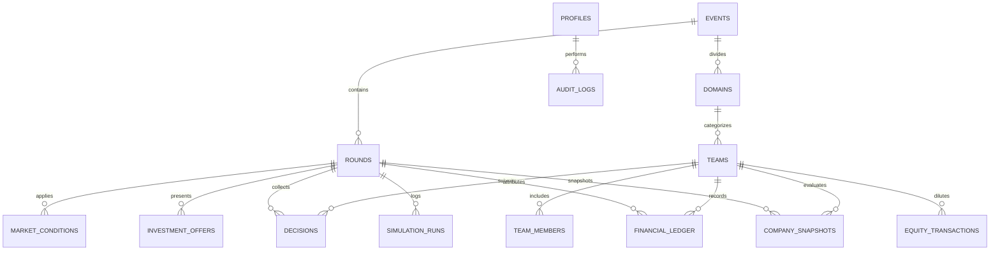

# CAPITAL QUEST — DATABASE SCHEMA & POSTGRESQL ARCHITECTURE

**Document Reference:** `CQ-SPEC-04`  
**Status:** Implementation-Ready Specification  
**Target Engine:** Supabase PostgreSQL 15+  
**Version:** 1.0.0-PROPOSED  

---

## 1. Schema Overview & Design Principles

The Capital Quest database architecture is engineered to guarantee:
1. **Double-Entry Financial Integrity:** Financial state transitions are recorded as immutable journal entries in `financial_ledger`. Snapshots (`company_snapshots`) are deterministic aggregations of ledger state.
2. **Strict Referential Integrity & Constraints:** Numeric monetary values use `NUMERIC(15, 2)` (zero floating-point inaccuracy). Ownership shares use `NUMERIC(7, 4)` (e.g., $100.0000\%$). Check constraints prevent negative inventory, impossible equity states, or unauthorized status jumps.
3. **Auditability & Safe Reversal:** Every round simulation is sealed with an idempotency key and input hash in `simulation_runs`. Rollbacks execute within single atomic transactions that purge generated snapshots and ledger entries without leaving orphaned state.
4. **Row-Level Security (RLS):** Authorization is enforced at the database layer using Supabase Auth JWT claims, preventing data leakage to unprivileged roles.

---

## 2. Entity-Relationship Model



---

## 3. PostgreSQL DDL (Normalized Schema)

### 3.1 Custom Enums & Types

```sql
-- Security & System Roles
CREATE TYPE user_role AS ENUM (
    'super_admin',
    'domain_coordinator',
    'volunteer',
    'judge',
    'public_observer'
);

-- Event Lifecycle
CREATE TYPE event_status AS ENUM (
    'setup',
    'active',
    'paused',
    'completed',
    'archived'
);

-- Round Status Lifecycle
CREATE TYPE round_status AS ENUM (
    'draft',
    'open',
    'locked',
    'simulated',
    'reviewed',
    'published'
);

-- Round Classification
CREATE TYPE round_type AS ENUM (
    'regular',
    'investment_seed',
    'investment_series_a',
    'final_harvest'
);

-- Volunteer Slip Entry Status
CREATE TYPE decision_status AS ENUM (
    'unsubmitted',
    'entered',
    'verified',
    'locked',
    'flagged'
);

-- Investment Choices
CREATE TYPE investment_choice AS ENUM (
    'none',
    'offer_a',
    'offer_b',
    'reject_both'
);

-- Financial Ledger Entry Classifications
CREATE TYPE ledger_entry_type AS ENUM (
    'initial_grant',
    'marketing_expense',
    'rd_expense',
    'operations_expense',
    'production_cost',
    'sales_revenue',
    'holding_cost',
    'tax_payment',
    'investor_funding',
    'emergency_loan_draw',
    'emergency_loan_repay',
    'admin_penalty'
);
```

---

### 3.2 Core Identity & Event Administration Tables

```sql
-- 1. User Profiles (Extends Supabase auth.users)
CREATE TABLE profiles (
    id UUID PRIMARY KEY REFERENCES auth.users(id) ON DELETE CASCADE,
    email TEXT NOT NULL UNIQUE,
    full_name TEXT NOT NULL,
    role user_role NOT NULL DEFAULT 'volunteer',
    assigned_domain_id UUID,
    is_active BOOLEAN NOT NULL DEFAULT true,
    created_at TIMESTAMPTZ NOT NULL DEFAULT timezone('utc', now()),
    updated_at TIMESTAMPTZ NOT NULL DEFAULT timezone('utc', now())
);

-- 2. Tournament Events
CREATE TABLE events (
    id UUID PRIMARY KEY DEFAULT gen_random_uuid(),
    slug TEXT NOT NULL UNIQUE,
    name TEXT NOT NULL,
    description TEXT,
    status event_status NOT NULL DEFAULT 'setup',
    total_rounds INTEGER NOT NULL DEFAULT 5 CHECK (total_rounds BETWEEN 3 AND 10),
    starting_capital NUMERIC(15, 2) NOT NULL DEFAULT 1000000.00 CHECK (starting_capital > 0),
    starting_valuation NUMERIC(15, 2) NOT NULL DEFAULT 200000.00 CHECK (starting_valuation > 0),
    active_round_number INTEGER NOT NULL DEFAULT 0,
    created_by UUID REFERENCES profiles(id),
    created_at TIMESTAMPTZ NOT NULL DEFAULT timezone('utc', now()),
    updated_at TIMESTAMPTZ NOT NULL DEFAULT timezone('utc', now())
);

-- 3. Business Domains (4 Core Industry Divisions)
CREATE TABLE domains (
    id UUID PRIMARY KEY DEFAULT gen_random_uuid(),
    event_id UUID NOT NULL REFERENCES events(id) ON DELETE CASCADE,
    code TEXT NOT NULL, -- 'CLEANTECH', 'HEALTHTECH', 'SAAS_AI', 'D2C_GOODS'
    name TEXT NOT NULL,
    description TEXT,
    base_demand INTEGER NOT NULL CHECK (base_demand > 0),
    benchmark_price NUMERIC(15, 2) NOT NULL CHECK (benchmark_price > 0),
    min_allowed_price NUMERIC(15, 2) NOT NULL,
    max_allowed_price NUMERIC(15, 2) NOT NULL,
    base_unit_cogs NUMERIC(15, 2) NOT NULL CHECK (base_unit_cogs >= 0),
    unit_holding_cost NUMERIC(15, 2) NOT NULL DEFAULT 0.00,
    rd_elasticity NUMERIC(5, 4) NOT NULL DEFAULT 0.75,
    rd_retention_rate NUMERIC(5, 4) NOT NULL DEFAULT 0.70,
    mkt_elasticity NUMERIC(5, 4) NOT NULL DEFAULT 0.75,
    mkt_retention_rate NUMERIC(5, 4) NOT NULL DEFAULT 0.50,
    price_elasticity NUMERIC(5, 4) NOT NULL DEFAULT 1.20,
    quality_regulatory_floor NUMERIC(5, 2) NOT NULL DEFAULT 20.00,
    created_at TIMESTAMPTZ NOT NULL DEFAULT timezone('utc', now()),
    CONSTRAINT uq_event_domain_code UNIQUE (event_id, code),
    CONSTRAINT chk_price_range CHECK (min_allowed_price <= benchmark_price AND benchmark_price <= max_allowed_price)
);

-- Add foreign key constraint back to profiles for assigned domain
ALTER TABLE profiles ADD CONSTRAINT fk_assigned_domain FOREIGN KEY (assigned_domain_id) REFERENCES domains(id) ON DELETE SET NULL;
```

---

### 3.3 Team, Roster & Round Management Tables

```sql
-- 4. Teams / Virtual Enterprises
CREATE TABLE teams (
    id UUID PRIMARY KEY DEFAULT gen_random_uuid(),
    event_id UUID NOT NULL REFERENCES events(id) ON DELETE CASCADE,
    domain_id UUID NOT NULL REFERENCES domains(id) ON DELETE RESTRICT,
    team_code TEXT NOT NULL, -- e.g. 'CT-01', 'HT-03'
    company_name TEXT NOT NULL,
    table_station TEXT, -- Physical room / table identifier
    is_disqualified BOOLEAN NOT NULL DEFAULT false,
    created_at TIMESTAMPTZ NOT NULL DEFAULT timezone('utc', now()),
    updated_at TIMESTAMPTZ NOT NULL DEFAULT timezone('utc', now()),
    CONSTRAINT uq_event_team_code UNIQUE (event_id, team_code),
    CONSTRAINT uq_event_company_name UNIQUE (event_id, company_name)
);

-- 5. Team Student Members (Roster)
CREATE TABLE team_members (
    id UUID PRIMARY KEY DEFAULT gen_random_uuid(),
    team_id UUID NOT NULL REFERENCES teams(id) ON DELETE CASCADE,
    full_name TEXT NOT NULL,
    email TEXT,
    student_id TEXT,
    role_title TEXT DEFAULT 'Co-Founder',
    created_at TIMESTAMPTZ NOT NULL DEFAULT timezone('utc', now())
);

-- 6. Simulation Rounds
CREATE TABLE rounds (
    id UUID PRIMARY KEY DEFAULT gen_random_uuid(),
    event_id UUID NOT NULL REFERENCES events(id) ON DELETE CASCADE,
    round_number INTEGER NOT NULL CHECK (round_number BETWEEN 1 AND 10),
    type round_type NOT NULL DEFAULT 'regular',
    status round_status NOT NULL DEFAULT 'draft',
    opened_at TIMESTAMPTZ,
    locked_at TIMESTAMPTZ,
    simulated_at TIMESTAMPTZ,
    published_at TIMESTAMPTZ,
    created_at TIMESTAMPTZ NOT NULL DEFAULT timezone('utc', now()),
    CONSTRAINT uq_event_round_number UNIQUE (event_id, round_number)
);
```

---

### 3.4 Decision Entry & Market Shock Tables

```sql
-- 7. Team Decision Records (Physical Slip Digitization)
CREATE TABLE decisions (
    id UUID PRIMARY KEY DEFAULT gen_random_uuid(),
    round_id UUID NOT NULL REFERENCES rounds(id) ON DELETE CASCADE,
    team_id UUID NOT NULL REFERENCES teams(id) ON DELETE CASCADE,
    status decision_status NOT NULL DEFAULT 'unsubmitted',
    marketing_budget NUMERIC(15, 2) NOT NULL DEFAULT 0.00 CHECK (marketing_budget >= 0),
    rd_budget NUMERIC(15, 2) NOT NULL DEFAULT 0.00 CHECK (rd_budget >= 0),
    production_units INTEGER NOT NULL DEFAULT 0 CHECK (production_units >= 0),
    unit_price NUMERIC(15, 2) NOT NULL DEFAULT 0.00 CHECK (unit_price >= 0),
    operations_budget NUMERIC(15, 2) NOT NULL DEFAULT 0.00 CHECK (operations_budget >= 0),
    investment_decision investment_choice NOT NULL DEFAULT 'none',
    entered_by UUID REFERENCES profiles(id),
    entered_at TIMESTAMPTZ,
    verified_by UUID REFERENCES profiles(id),
    verified_at TIMESTAMPTZ,
    admin_override_notes TEXT,
    created_at TIMESTAMPTZ NOT NULL DEFAULT timezone('utc', now()),
    updated_at TIMESTAMPTZ NOT NULL DEFAULT timezone('utc', now()),
    CONSTRAINT uq_round_team_decision UNIQUE (round_id, team_id)
);

-- 8. Seeded Market Events
CREATE TABLE market_events (
    id UUID PRIMARY KEY DEFAULT gen_random_uuid(),
    event_id UUID NOT NULL REFERENCES events(id) ON DELETE CASCADE,
    domain_id UUID REFERENCES domains(id) ON DELETE CASCADE, -- NULL means Global / All Domains
    name TEXT NOT NULL,
    description TEXT NOT NULL,
    activation_round INTEGER NOT NULL CHECK (activation_round BETWEEN 1 AND 10),
    demand_multiplier NUMERIC(5, 4) NOT NULL DEFAULT 1.0000,
    cost_multiplier NUMERIC(5, 4) NOT NULL DEFAULT 1.0000,
    price_elasticity_modifier NUMERIC(5, 4) NOT NULL DEFAULT 0.0000,
    quality_sensitivity_modifier NUMERIC(5, 4) NOT NULL DEFAULT 0.0000,
    is_pre_announced BOOLEAN NOT NULL DEFAULT true,
    is_active BOOLEAN NOT NULL DEFAULT true,
    created_at TIMESTAMPTZ NOT NULL DEFAULT timezone('utc', now())
);

-- 9. Investment Round Offers
CREATE TABLE investment_offers (
    id UUID PRIMARY KEY DEFAULT gen_random_uuid(),
    round_id UUID NOT NULL REFERENCES rounds(id) ON DELETE CASCADE,
    domain_id UUID REFERENCES domains(id) ON DELETE CASCADE, -- NULL means applies to all domains
    offer_code TEXT NOT NULL, -- 'OFFER_A', 'OFFER_B'
    investor_name TEXT NOT NULL,
    funding_amount NUMERIC(15, 2) NOT NULL CHECK (funding_amount > 0),
    equity_stake_percentage NUMERIC(7, 4) NOT NULL CHECK (equity_stake_percentage > 0 AND equity_stake_percentage < 100),
    implied_valuation NUMERIC(15, 2) GENERATED ALWAYS AS (funding_amount / (equity_stake_percentage / 100.0)) STORED,
    description TEXT,
    created_at TIMESTAMPTZ NOT NULL DEFAULT timezone('utc', now()),
    CONSTRAINT uq_round_offer_code UNIQUE (round_id, domain_id, offer_code)
);
```

---

### 3.5 Financial Ledger, Cap Table & Simulation Snapshots

```sql
-- 10. Immutable Financial Ledger (Double-Entry Cash Tracking)
CREATE TABLE financial_ledger (
    id UUID PRIMARY KEY DEFAULT gen_random_uuid(),
    event_id UUID NOT NULL REFERENCES events(id) ON DELETE CASCADE,
    round_id UUID REFERENCES rounds(id) ON DELETE CASCADE,
    team_id UUID NOT NULL REFERENCES teams(id) ON DELETE CASCADE,
    entry_type ledger_entry_type NOT NULL,
    amount NUMERIC(15, 2) NOT NULL, -- Positive for Cash Inflow (Credit), Negative for Outflow (Debit)
    running_balance NUMERIC(15, 2) NOT NULL,
    reference_id UUID, -- Links to decision_id, offer_id, etc.
    simulation_run_id UUID, -- Links to specific simulation run
    is_voided BOOLEAN NOT NULL DEFAULT false, -- True if transaction was voided by an auditable correction
    voided_at TIMESTAMPTZ,
    void_reason TEXT,
    description TEXT NOT NULL,
    created_at TIMESTAMPTZ NOT NULL DEFAULT timezone('utc', now())
);

-- 11. Cap Table & Equity Transactions
CREATE TABLE equity_transactions (
    id UUID PRIMARY KEY DEFAULT gen_random_uuid(),
    team_id UUID NOT NULL REFERENCES teams(id) ON DELETE CASCADE,
    round_id UUID NOT NULL REFERENCES rounds(id) ON DELETE CASCADE,
    simulation_run_id UUID,
    shareholder_name TEXT NOT NULL, -- e.g., 'Founding Team', 'Seed VC (Offer A)'
    is_founding_team BOOLEAN NOT NULL DEFAULT false,
    pre_round_equity_pct NUMERIC(7, 4) NOT NULL CHECK (pre_round_equity_pct >= 0 AND pre_round_equity_pct <= 100),
    dilution_delta_pct NUMERIC(7, 4) NOT NULL, -- Negative if diluted, Positive if newly issued
    post_round_equity_pct NUMERIC(7, 4) NOT NULL CHECK (post_round_equity_pct >= 0 AND post_round_equity_pct <= 100),
    investment_amount NUMERIC(15, 2) NOT NULL DEFAULT 0.00,
    is_voided BOOLEAN NOT NULL DEFAULT false,
    created_at TIMESTAMPTZ NOT NULL DEFAULT timezone('utc', now())
);

-- 12. Company End-of-Round Performance Snapshots
CREATE TABLE company_snapshots (
    id UUID PRIMARY KEY DEFAULT gen_random_uuid(),
    round_id UUID NOT NULL REFERENCES rounds(id) ON DELETE CASCADE,
    team_id UUID NOT NULL REFERENCES teams(id) ON DELETE CASCADE,
    simulation_run_id UUID,
    snapshot_version INTEGER NOT NULL DEFAULT 1,
    is_active BOOLEAN NOT NULL DEFAULT true, -- Only active snapshot represents current state
    
    -- Operational & Market Performance
    product_quality_index NUMERIC(7, 2) NOT NULL,
    brand_equity_score NUMERIC(15, 2) NOT NULL,
    attractiveness_score NUMERIC(15, 4) NOT NULL,
    market_share_pct NUMERIC(7, 4) NOT NULL,
    potential_demand INTEGER NOT NULL,
    units_available INTEGER NOT NULL,
    units_sold INTEGER NOT NULL,
    units_stockout INTEGER NOT NULL,
    ending_inventory INTEGER NOT NULL,
    
    -- Financial Statements
    gross_revenue NUMERIC(15, 2) NOT NULL,
    cogs NUMERIC(15, 2) NOT NULL,
    gross_profit NUMERIC(15, 2) NOT NULL,
    operating_expenses NUMERIC(15, 2) NOT NULL,
    inventory_holding_cost NUMERIC(15, 2) NOT NULL,
    ebitda NUMERIC(15, 2) NOT NULL,
    tax_expense NUMERIC(15, 2) NOT NULL,
    net_income NUMERIC(15, 2) NOT NULL,
    operating_cash_flow NUMERIC(15, 2) NOT NULL,
    financing_cash_flow NUMERIC(15, 2) NOT NULL,
    ending_cash NUMERIC(15, 2) NOT NULL,
    
    -- Capital Structure & Valuation
    cumulative_rd_asset NUMERIC(15, 2) NOT NULL,
    enterprise_value NUMERIC(15, 2) NOT NULL,
    cash_valuation_contribution NUMERIC(15, 2) NOT NULL,
    company_valuation NUMERIC(15, 2) NOT NULL,
    retained_equity_pct NUMERIC(7, 4) NOT NULL,
    equity_adjusted_score NUMERIC(18, 2) NOT NULL,
    
    -- Rank Standings
    domain_rank INTEGER NOT NULL,
    tournament_rank INTEGER NOT NULL,
    
    created_at TIMESTAMPTZ NOT NULL DEFAULT timezone('utc', now()),
    CONSTRAINT uq_round_team_snapshot_version UNIQUE (round_id, team_id, snapshot_version)
);

-- 13. Simulation Execution Audit Runs
CREATE TABLE simulation_runs (
    id UUID PRIMARY KEY DEFAULT gen_random_uuid(),
    round_id UUID NOT NULL REFERENCES rounds(id) ON DELETE CASCADE,
    executed_by UUID NOT NULL REFERENCES profiles(id),
    idempotency_key TEXT NOT NULL UNIQUE,
    run_version INTEGER NOT NULL DEFAULT 1,
    is_active BOOLEAN NOT NULL DEFAULT true,
    input_state_hash TEXT NOT NULL,
    execution_duration_ms INTEGER NOT NULL,
    total_companies_simulated INTEGER NOT NULL,
    is_dry_run BOOLEAN NOT NULL DEFAULT false,
    status TEXT NOT NULL DEFAULT 'completed', -- 'completed', 'superseded', 'voided'
    void_reason TEXT,
    error_payload JSONB,
    created_at TIMESTAMPTZ NOT NULL DEFAULT timezone('utc', now())
);

-- 14. Immutable System Audit Logs
CREATE TABLE audit_logs (
    id UUID PRIMARY KEY DEFAULT gen_random_uuid(),
    actor_id UUID REFERENCES profiles(id),
    action TEXT NOT NULL, -- 'LOCK_ROUND', 'ENTER_DECISION', 'OVERRIDE_DECISION', 'ROLLBACK_ROUND'
    entity_name TEXT NOT NULL,
    entity_id UUID NOT NULL,
    before_state JSONB,
    after_state JSONB,
    ip_address INET,
    user_agent TEXT,
    created_at TIMESTAMPTZ NOT NULL DEFAULT timezone('utc', now())
);
```

---

## 4. Performance Indexes

```sql
-- Performance Indexes for Real-Time Leaderboard & Volunteer Console
CREATE INDEX idx_teams_event_domain ON teams(event_id, domain_id);
CREATE INDEX idx_decisions_round_status ON decisions(round_id, status);
CREATE INDEX idx_financial_ledger_team_round ON financial_ledger(team_id, round_id);
CREATE INDEX idx_snapshots_round_score ON company_snapshots(round_id, equity_adjusted_score DESC);
CREATE INDEX idx_snapshots_team ON company_snapshots(team_id);
CREATE INDEX idx_audit_logs_entity ON audit_logs(entity_name, entity_id);
CREATE INDEX idx_simulation_runs_round ON simulation_runs(round_id);
```

---

## 5. Row-Level Security (RLS) Policies

All tables have RLS enabled by default:

```sql
ALTER TABLE profiles ENABLE ROW LEVEL SECURITY;
ALTER TABLE events ENABLE ROW LEVEL SECURITY;
ALTER TABLE domains ENABLE ROW LEVEL SECURITY;
ALTER TABLE teams ENABLE ROW LEVEL SECURITY;
ALTER TABLE rounds ENABLE ROW LEVEL SECURITY;
ALTER TABLE decisions ENABLE ROW LEVEL SECURITY;
ALTER TABLE market_events ENABLE ROW LEVEL SECURITY;
ALTER TABLE investment_offers ENABLE ROW LEVEL SECURITY;
ALTER TABLE financial_ledger ENABLE ROW LEVEL SECURITY;
ALTER TABLE equity_transactions ENABLE ROW LEVEL SECURITY;
ALTER TABLE company_snapshots ENABLE ROW LEVEL SECURITY;
ALTER TABLE simulation_runs ENABLE ROW LEVEL SECURITY;
ALTER TABLE audit_logs ENABLE ROW LEVEL SECURITY;
```

### 5.1 Helper Security Functions

```sql
-- Get current user role from profiles
CREATE OR REPLACE FUNCTION auth.get_user_role()
RETURNS user_role AS $$
    SELECT role FROM public.profiles WHERE id = auth.uid();
$$ LANGUAGE sql STABLE SECURITY DEFINER;

-- Check if user is Super Admin
CREATE OR REPLACE FUNCTION auth.is_super_admin()
RETURNS BOOLEAN AS $$
    SELECT (auth.get_user_role() = 'super_admin');
$$ LANGUAGE sql STABLE SECURITY DEFINER;

-- Check if user is Volunteer or Admin
CREATE OR REPLACE FUNCTION auth.is_staff()
RETURNS BOOLEAN AS $$
    SELECT auth.get_user_role() IN ('super_admin', 'domain_coordinator', 'volunteer');
$$ LANGUAGE sql STABLE SECURITY DEFINER;
```

### 5.2 Policy Implementations

```sql
-- PROFILES: Users read self; Admins read all; Admins update roles
CREATE POLICY profiles_read_self_or_admin ON profiles
    FOR SELECT TO authenticated
    USING (id = auth.uid() OR auth.is_super_admin());

CREATE POLICY profiles_admin_manage ON profiles
    FOR ALL TO authenticated
    USING (auth.is_super_admin());

-- EVENTS: Public can read active events; Only Super Admin can mutate
CREATE POLICY events_read_public ON events
    FOR SELECT TO anon, authenticated
    USING (true);

CREATE POLICY events_admin_mutate ON events
    FOR ALL TO authenticated
    USING (auth.is_super_admin());

-- DECISIONS: Volunteers can insert/update during OPEN round
CREATE POLICY decisions_volunteer_manage ON decisions
    FOR ALL TO authenticated
    USING (
        auth.is_staff() AND 
        EXISTS (
            SELECT 1 FROM rounds 
            WHERE rounds.id = decisions.round_id 
            AND rounds.status = 'open'
        )
    );

CREATE POLICY decisions_admin_all ON decisions
    FOR ALL TO authenticated
    USING (auth.is_super_admin());

-- COMPANY SNAPSHOTS: Published rounds are visible to everyone; Unseen provisional visible only to Admin/Judge
CREATE POLICY snapshots_read_policy ON company_snapshots
    FOR SELECT TO anon, authenticated
    USING (
        EXISTS (
            SELECT 1 FROM rounds 
            WHERE rounds.id = company_snapshots.round_id 
            AND rounds.status = 'published'
        ) OR auth.is_super_admin() OR auth.get_user_role() = 'judge'
    );
```

---

## 6. Atomic Simulation & Versioned Non-Destructive Correction Functions (F-02 Fix)

To ensure simulation idempotency and forensic financial auditability, round corrections **never silently delete** published financial or equity history. Instead, corrections use versioned simulation runs, soft-voiding, and strict cascade guards:

```sql
-- Atomic Stored Procedure: Execute Versioned Round Correction / Void
CREATE OR REPLACE FUNCTION fn_void_or_supersede_round(
    p_round_id UUID, 
    p_admin_id UUID,
    p_void_reason TEXT
)
RETURNS JSONB AS $$
DECLARE
    v_round_record rounds%ROWTYPE;
    v_event_record events%ROWTYPE;
    v_active_sim_run simulation_runs%ROWTYPE;
    v_next_round_active BOOLEAN;
    v_voided_snapshots INTEGER := 0;
    v_voided_ledger INTEGER := 0;
    v_voided_equity INTEGER := 0;
BEGIN
    -- 1. Verify caller is super_admin
    IF (SELECT role FROM profiles WHERE id = p_admin_id) != 'super_admin' THEN
        RAISE EXCEPTION 'Unauthorized: Only Super Admin can execute round corrections.';
    END IF;

    -- 2. Validate non-empty audit reason
    IF p_void_reason IS NULL OR length(trim(p_void_reason)) < 10 THEN
        RAISE EXCEPTION 'Audit Validation Error: A detailed reason (min 10 chars) is required.';
    END IF;

    -- 3. Fetch and lock round row
    SELECT * INTO v_round_record FROM rounds WHERE id = p_round_id FOR UPDATE;
    IF NOT FOUND THEN
        RAISE EXCEPTION 'Round not found: %', p_round_id;
    END IF;

    IF v_round_record.status NOT IN ('simulated', 'reviewed', 'published') THEN
        RAISE EXCEPTION 'Cannot void round in state: %', v_round_record.status;
    END IF;

    -- 4. CASCADE GUARD: Check if any subsequent round has already been opened/simulated
    SELECT EXISTS (
        SELECT 1 FROM rounds 
        WHERE event_id = v_round_record.event_id 
        AND round_number > v_round_record.round_number 
        AND status NOT IN ('draft')
    ) INTO v_next_round_active;

    IF v_next_round_active THEN
        RAISE EXCEPTION 'Cascade Guard Blocker: Cannot void Round % because a subsequent round is already open or processed. Revert subsequent rounds first in reverse chronological order.', v_round_record.round_number;
    END IF;

    -- 5. Fetch currently active simulation run
    SELECT * INTO v_active_sim_run 
    FROM simulation_runs 
    WHERE round_id = p_round_id AND is_active = true 
    ORDER BY run_version DESC LIMIT 1 FOR UPDATE;

    -- 6. NON-DESTRUCTIVE VOIDING: Deactivate and mark voided rather than DELETE
    IF FOUND THEN
        UPDATE simulation_runs 
        SET is_active = false, 
            status = 'voided', 
            void_reason = p_void_reason 
        WHERE id = v_active_sim_run.id;

        -- Deactivate Snapshots (Preserved for audit, but excluded from leaderboard)
        UPDATE company_snapshots 
        SET is_active = false 
        WHERE simulation_run_id = v_active_sim_run.id;
        GET DIAGNOSTICS v_voided_snapshots = ROW_COUNT;

        -- Void Financial Ledger entries (Marked voided with reason, balance preserved)
        UPDATE financial_ledger 
        SET is_voided = true, 
            voided_at = timezone('utc', now()), 
            void_reason = p_void_reason 
        WHERE simulation_run_id = v_active_sim_run.id;
        GET DIAGNOSTICS v_voided_ledger = ROW_COUNT;

        -- Void Equity Transactions
        UPDATE equity_transactions 
        SET is_voided = true 
        WHERE simulation_run_id = v_active_sim_run.id;
        GET DIAGNOSTICS v_voided_equity = ROW_COUNT;
    END IF;

    -- 7. Restore Round Status to LOCKED for review and re-simulation
    UPDATE rounds 
    SET status = 'locked', simulated_at = NULL, published_at = NULL 
    WHERE id = p_round_id;

    -- 8. Permanent Audit Log Entry
    INSERT INTO audit_logs (actor_id, action, entity_name, entity_id, before_state, after_state)
    VALUES (
        p_admin_id, 
        'VOID_ROUND_SIMULATION', 
        'rounds', 
        p_round_id, 
        jsonb_build_object('status', v_round_record.status, 'run_id', v_active_sim_run.id), 
        jsonb_build_object('status', 'locked', 'void_reason', p_void_reason, 'voided_snapshots', v_voided_snapshots, 'voided_ledger', v_voided_ledger)
    );

    RETURN jsonb_build_object(
        'success', true,
        'round_id', p_round_id,
        'previous_status', v_round_record.status,
        'new_status', 'locked',
        'voided_simulation_run_id', v_active_sim_run.id,
        'voided_snapshots', v_voided_snapshots,
        'voided_ledger_entries', v_voided_ledger,
        'voided_equity_records', v_voided_equity
    );
END;
$$ LANGUAGE plpgsql SECURITY DEFINER;
```
