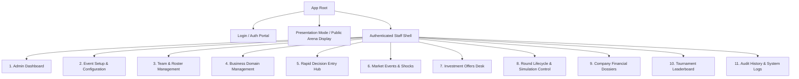

# CAPITAL QUEST — SCREEN & NAVIGATION SPECIFICATION

**Document Reference:** `CQ-SPEC-06`  
**Status:** Implementation-Ready Specification  
**Design System:** Tailwind CSS + shadcn/ui + Radix UI + Recharts  
**Version:** 1.0.0-PROPOSED  

---

## 1. Design System & Global Information Architecture

### 1.1 Aesthetic Principles
- **Theme:** High-contrast Dark Slate / Deep Navy primary theme (`#090D16` surface, `#131B2E` cards, `#1E293B` borders), with a crisp clean light-mode fallback for standard office printing.
- **Accent Tones:** Strategic Emerald (`#10B981`) for liquidity and positive ROI, Royal Indigo (`#6366F1`) for primary actions, Amber (`#F59E0B`) for warnings and pending reviews, and Rose Crimson (`#F43F5E`) for insolvency or overspending errors.
- **Typography:**
  - Display / Headings: `Outfit` or `Plus Jakarta Sans` (Geometrical, modern, confident).
  - Body & Form Controls: `Inter` (Legible at small sizes).
  - Financial Data & NumPad Entry: `JetBrains Mono` or tabular `Fira Code` (Monospaced, tabular numbers with aligned decimal points).
- **Projector Legibility Standard:** High-contrast elements, minimum font sizes of $24\text{px}$ on presentation slides, and anti-glare color contrast exceeding WCAG AAA standards ($7:1$).

---

### 1.2 Global Navigation Tree



---

## 2. Detailed Screen Specifications

---

### Screen 1: Admin Dashboard (Command Center)
- **Route:** `/admin/dashboard`
- **Primary Users:** Super Admin, Domain Coordinators.
- **Purpose:** High-level operational pulse of the live competition.
- **Key Components:**
  1. **Tournament Status Banner:** Active Event Name, Current Round Indicator (e.g., "Round 3 of 5 — LOCKED"), Master Timer Countdown.
  2. **Executive KPI Cards (4-Grid):**
     - Total Competing Companies (e.g., `36 Active / 0 Disqualified`).
     - Global Market GDP (Sum of all round revenues).
     - Average Company Valuation (e.g., `$3,420,500`).
     - Data Digitization Progress Bar (e.g., `36 / 36 Slips Verified [100%]`).
  3. **Domain Quick-Health Cards (4 Cards):** Real-time snapshot of demand fulfillment, average pricing, and leader company per domain.
  4. **Action Bar:** Primary call-to-action buttons ("Advance Round", "Open Entry", "Launch Presentation View").
- **States:**
  - *Loading:* Skeleton pulse shimmer on KPI cards and domain grid.
  - *Empty:* "No active tournament found. [Initialize New Event]".
  - *Error:* Red alert banner with retry trigger.

---

### Screen 2: Event Setup & Global Parameters
- **Route:** `/admin/events/setup`
- **Primary Users:** Super Admin.
- **Purpose:** Provisioning a new tournament instance with immutable financial foundations.
- **Form Fields:**
  - Event Name (`Input: text`).
  - Total Rounds (`Select: 3 to 10`, default `5`).
  - Starting Operating Capital (`Input: currency`, default `$1,000,000.00`).
  - Initial Benchmark Valuation (`Input: currency`, default `$200,000.00`).
  - Investment Window Schedule (`Checkboxes: Round 2, Round 4`).
  - Default Currency Symbol (`Input: text`, default `vUSD`).
- **Confirmation State:** Modal dialog requiring typed confirmation (`"CONFIRM START $1,000,000"`) before locking global tournament economics.

---

### Screen 3: Team Management & Roster Onboarding
- **Route:** `/admin/teams`
- **Primary Users:** Super Admin, Domain Coordinators.
- **Purpose:** Enrolling 20–40 teams, generating team codes, assigning physical tables and industry domains.
- **Key Components:**
  - **Batch CSV Import Dropzone:** Drag-and-drop CSV parser with automatic schema validation and preview table.
  - **Filter Toolbar:** Domain Filter Tabs (`All`, `CleanTech`, `HealthTech`, `SaaS`, `D2C`), Search by Team Code / Company Name.
  - **Data Table:** Team Code, Company Name, Assigned Domain Badge, Table Station, Roster Count, Initial Balance Status (`$1.00M Verified`), Actions (Edit, Reassign, Disqualify).
- **Responsive Layout:**
  - Desktop: Full 8-column data table.
  - Tablet/Mobile: Compact cards with expandable accordion details.

---

### Screen 4: Business Domain Management
- **Route:** `/admin/domains`
- **Primary Users:** Super Admin.
- **Purpose:** Fine-tuning economic elasticity, cost structures, and regulatory constraints per industry.
- **Key Components:**
  - **4-Tab Navigation:** `[CleanTech] [HealthTech] [Enterprise SaaS] [D2C Goods]`.
  - **Interactive Elasticity Sandbox:** Sliders for Price Elasticity ($\epsilon_p$), R&D Sensitivity ($\alpha_{\text{rd}}$), and Marketing Sensitivity ($\alpha_{\text{mkt}}$). Displays an interactive mini-curve of projected demand vs. price.
  - **Cost Parameter Form:** Benchmark Price, Minimum/Maximum Allowed Price, Base Unit COGS, Inventory Holding Cost per Unit.
- **Validation:** Visual warnings if min price $\ge$ max price or if elasticity creates mathematical asymptotes.

---

### Screen 5: Rapid Decision Entry Hub (Volunteer Console)
- **Route:** `/volunteer/entry`
- **Primary Users:** Volunteer Data Operators.
- **Design Priority:** High-speed 10-key numeric entry, keyboard-first navigation, instant calculation feedback, zero required mouse interactions.

```
+----------------------------------------------------------------------------------------------------+
| CAPITAL QUEST VOLUNTEER DIGITIZATION CONSOLE                          Round: [ 2 - OPEN ]          |
+----------------------------------------------------------------------------------------------------+
| Select Team: [ CT-04 | HelioGrid Dynamics           v]  Table: 4A    Available Cash: $ 886,800.00  |
+----------------------------------------------------------------------------------------------------+
|  FIELD NAME                    INPUT VALUE (10-KEY)        REAL-TIME VALIDATION & CONSTRAINTS      |
|  ------------------------------------------------------------------------------------------------- |
|  1. Marketing Budget ($):      [ 180,000         ]         Ok (20.3% of Cash)                      |
|  2. R&D Budget ($):            [ 220,000         ]         Ok (24.8% of Cash)                      |
|  3. Production Order (Units):  [   1,200         ] units   Mfg Cost: $691,200 ($576/unit)          |
|  4. Unit Selling Price ($):    [   1,350         ]         Range: $800 - $1,800 [VALID]            |
|  5. Operations Budget ($):     [ 100,000         ]         4% Cost Discount Applied                |
|  6. Investment Decision:       ( ) Offer A   (X) Offer B   ( ) Reject Both                         |
+----------------------------------------------------------------------------------------------------+
|  TOTAL PLANNED OUTFLOW:  $ 1,191,200.00   >>> ERROR: EXCEEDS AVAILABLE CASH BY $304,400.00 <<<    |
|  [F2: Clear]   [Strict Solvency: Rejection of Overspending]   [F9: Flag Slip]   [Enter: SUBMIT]    |
+----------------------------------------------------------------------------------------------------+
```

#### Special Volunteer Features:
1. **NumPad Hotkeys:**
   - `Enter` / `Tab`: Moves focus to next field.
   - `Shift + Tab`: Moves focus to previous field.
   - `F8`: *(Obsolete / Disabled in MVP)* Automatic spending modification is disabled per MVP tournament rules. Planned outflows exceeding available cash are strictly rejected, requiring an authorized corrected decision sheet.
   - `F9`: Flags slip as "Illegible / Disputed" and opens coordinator ticket.
   - `Ctrl + Enter`: Commits valid slip and immediately resets form with cursor focused on Team Code input for the next slip.
2. **Dual-Key Verification Mode:**
   - Operator B is presented with a blind entry mask for the same team. If Operator B's inputs match Operator A's inputs $100\%$, record changes to `VERIFIED` with green audio chime.

---

### Screen 6: Market Configuration & Seeded Events
- **Route:** `/admin/market`
- **Primary Users:** Super Admin.
- **Purpose:** Reviewing, activating, and scheduling seeded industry shocks.
- **Key Components:**
  - **Round Timeline Rail:** Visual timeline showing when events trigger (Round 1 to 5).
  - **Event Card Deck:** Displays active events, target domains, mathematical multipliers, and advance notice status (`Pre-Announced` vs `Black Swan`).
  - **Simulation Shock Preview:** Allows admin to test event impact on mock data before running official simulation.

---

### Screen 7: Investment Offers Desk
- **Route:** `/admin/investments`
- **Primary Users:** Super Admin.
- **Purpose:** Configuring VC terms for Round 2 and Round 4; monitoring team acceptance selections.
- **Key Components:**
  - **Term Sheet Builder:** Offer Code, Investor Persona Name, Funding Amount ($), Post-Money Equity Share (%). Automatically computes Implied Valuation and Pre-Money Valuation.
  - **Live Decision Tracker (during active round):** Real-time tally of team selections:
    - `Offer A`: 14 Teams ($38.9\%$)
    - `Offer B`: 18 Teams ($50.0\%$)
    - `Reject Both`: 4 Teams ($11.1\%$)

---

### Screen 8: Round Control & Simulation Hub
- **Route:** `/admin/rounds`
- **Primary Users:** Super Admin.
- **Purpose:** The nerve center for locking rounds, running simulation batches, reviewing provisional metrics, and executing rollbacks.
- **Key Components:**
  - **Submission Readiness Gauge:** Dial displaying digitized slips (e.g., `36/36 Verified`). Simulation button remains disabled until $100\%$ verified or missing teams explicitly overridden.
  - **Simulation Execution Console:**
    - Button: `"Run Dry-Run Simulation (Staging Only)"`
    - Button: `"Execute & Commit Official Round Simulation"`
  - **Execution Telemetry Box:** Displays server run duration (e.g., `1,142 ms`), checksum hash, companies simulated, and zero-leak sanity checks.
  - **Emergency Rollback Zone:** Red-bordered container with `"Rollback Round to Locked State"` button, protected by modal password confirmation.

---

### Screen 9: Company Performance Dossier
- **Route:** `/teams/[teamCode]/dossier`
- **Primary Users:** Student Teams, Judges, Admins.
- **Purpose:** Detailed financial and operational report card delivered to each team post-publication.
- **Key Components:**
  1. **Executive Metrics Strip:** Current Valuation, Retained Equity %, Cash Balance, Round Net Income, Domain Market Share %.
  2. **Financial Statements Tabset:**
     - **Income Statement:** Gross Revenue, COGS, Gross Margin, OpEx breakdown (Mkt, R&D, Ops, Holding), EBITDA, Taxes, Net Income.
     - **Balance Sheet:** Current Assets (Cash + Inventory Value), Intangible Assets (Capitalized R&D), Total Assets = Total Equity.
     - **Cash Flow Statement:** Cash from Operations, Cash from Financing (VC Inflow), Ending Cash.
  3. **Visual Analytics (Recharts):**
     - Trailing 5-Round Revenue vs. EBITDA Bar-Line Chart.
     - Product Quality vs. Domain Average Radar Chart.
     - Cap Table Pie Chart (Founding Team vs. Seed VC vs. Series A VC).

---

### Screen 10: Tournament Leaderboard
- **Route:** `/leaderboard`
- **Primary Users:** Public, Teams, Judges.
- **Purpose:** The official competitive rankings table.
- **Key Columns:**
  1. Rank (`#1` to `#40`) with upward/downward movement indicators ($\uparrow 3$, $\downarrow 1$, $-$).
  2. Company Name & Domain Badge.
  3. Company Valuation ($ vUSD).
  4. Retained Equity Percentage (%).
  5. **Final Tournament Score (Valuation $\times$ Retained Equity)** with bold highlight.
  6. Secondary Tie-Break Metrics: Total Cumulative Revenue, Total Net Income.
- **Filters:** Global Tournament view vs. Domain-Specific podium views.

---

### Screen 11: Presentation Mode (Arena Stage Display)
- **Route:** `/presentation`
- **Primary Users:** AV Crew, Master of Ceremonies, Stage Projector.
- **Design Standard:** 16:9 Aspect Ratio, High-Contrast Ultra-Dark Theme (`#050811`), ambient stage lighting accents, fluid 60 FPS transitions.
- **Modes & Views:**
  1. **Pre-Round Hype Screen:** Animated countdown clock, active domain briefing, seeded market event headlines.
  2. **Domain Race Screen:** Animated horizontal bar race showing market share shifts among companies across rounds.
  3. **Stage Reveal Ceremony ("The Podium Countdown"):**
     - Staggered reveals from Rank 10 to Rank 1.
     - Pressing `Spacebar` reveals the next rank with dramatic particle burst and valuation tally animation.
     - Top 3 Podium Winners celebration screen with confetti animation.
  4. **Spotlight Cards:** Automatic highlights for "Top Revenue Generator", "R&D Innovation Leader", and "Best Bootstrapped Venture".

---

### Screen 12: Audit History & System Logs
- **Route:** `/admin/audit`
- **Primary Users:** Super Admin, Independent Judges / Auditors.
- **Purpose:** Permanent, tamper-evident log of all system activities.
- **Key Components:**
  - Search by User, Action Type, or Team Code.
  - JSON State Diff Viewer: Side-by-side green/red visual diff of entity states before and after every manual edit or override.
  - Export Audit Trail button (Downloads cryptographically signed CSV/JSON).
