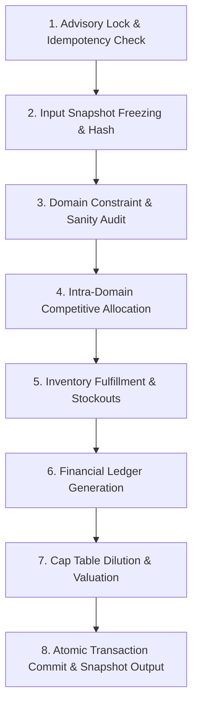
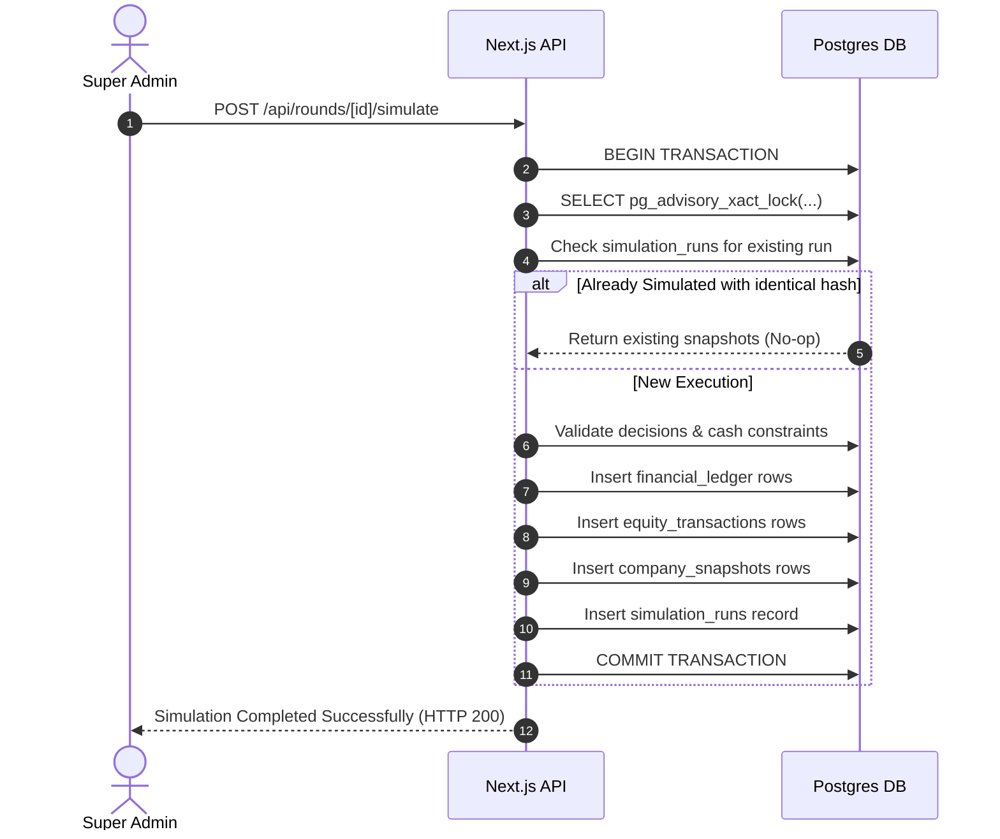

# CAPITAL QUEST — SIMULATION PROCESSING ARCHITECTURE

**Document Reference:** `CQ-SPEC-07`  
**Status:** Implementation-Ready Specification  
**Execution Runtime:** Node.js 20+ (Server-Side) / Supabase PostgreSQL Transaction  
**Version:** 1.0.0-PROPOSED  

---

## 1. Architectural Philosophy & Engine Invariants

The Capital Quest simulation engine is built upon five non-negotiable architectural mandates:

```
+----------------------------------------------------------------------------------------------------+
|                               FIVE NON-NEGOTIABLE ENGINE INVARIANTS                                |
+----------------------------------------------------------------------------------------------------+
| 1. ABSOLUTE DETERMINISM: Given identical input state S and decisions D, the simulation produces     |
|    identical output state S' across all platforms, CPU architectures, and execution environments.  |
|                                                                                                    |
| 2. ORDER INDEPENDENCE: The sequence in which companies are parsed or iterated inside the engine   |
|    has zero mathematical impact on market shares, customer demand, or financial outcomes.         |
|                                                                                                    |
| 3. DOUBLE-ENTRY CONSERVATION: Cash, units of inventory, and equity shares are strictly conserved.  |
|    No phantom money can enter or exit without an explicit double-entry ledger counterparty.       |
|                                                                                                    |
| 4. ATOMIC IDEMPOTENCY: Simulation runs are guarded by PostgreSQL advisory locks and SHA-256 input   |
|    digests. Re-executing an identical round produces identical states without duplicating rows.    |
|                                                                                                    |
| 5. FORENSIC AUDITABILITY & VERSIONED CORRECTIONS: Published financial and equity records are never  |
|    silently deleted. Round corrections deactivate snapshots and void ledger entries via versioning.|
+----------------------------------------------------------------------------------------------------+
```

---

## 2. End-to-End Simulation Pipeline

The simulation executes through an 8-stage synchronous batch pipeline inside an isolated database transaction:



### Pipeline Stage Details:

#### Stage 1: Transactional Lock & Concurrency Control
- Acquire a transaction-level PostgreSQL advisory lock:
  ```sql
  SELECT pg_advisory_xact_lock(hashtext('capital_quest_sim_' || p_round_id::text));
  ```
- Guarantees that even if two administrators click "Execute Simulation" simultaneously, exactly one execution occurs; the second request waits and detects the completed run.

#### Stage 2: Input Snapshot Freezing & Cryptographic Digest
- Lock all decisions for the round:
  ```sql
  UPDATE rounds SET status = 'simulated', simulated_at = timezone('utc', now()) WHERE id = p_round_id;
  ```
- Generate a canonical JSON representation of all decision inputs, domain parameters, and active market events, sorted deterministically by `team_id`.
- Compute a SHA-256 hash (`input_state_hash`). If a previous simulation run with this identical hash exists and was successful, return the existing snapshot.

#### Stage 3: Domain Constraint & Sanity Validation
- Verify that every active team has a valid decision record.
- Verify that no team has planned cash outflows exceeding its available beginning cash balance. If a minor deficit exists ($< 5\%$), trigger the automated pro-rata scaling rule.
- If unresolvable violations exist, abort the transaction and raise a descriptive error without modifying database state.

#### Stage 4: Intra-Domain Competitive Market Resolution
- Partition teams into their respective 4 domains.
- Compute cumulative R&D stocks ($K_{\text{rd}}$) and Brand Equity stocks ($B$).
- Calculate Product Quality Indices ($Q$) and Brand Factors ($\beta$).
- Evaluate Price Attractiveness ($\pi$) relative to domain benchmarks.
- Calculate Raw Attractiveness ($A_i$) and normalize to Market Share ($MS_i = \frac{A_i}{\sum A_j}$) using vector math across the entire domain array simultaneously.
- Compute Potential Customer Demand: $d_i = \lfloor D_{\text{domain}} \times MS_i \rfloor$.

#### Stage 5: Inventory Fulfillment, Sales & Stockout Redistribution
- Compare potential demand ($d_i$) with available units ($U_{\text{avail}, i} = U_{\text{beg}, i} + U_{\text{prod}, i}$).
- Allocate Units Sold: $U_{\text{sold}, i} = \min(d_i, U_{\text{avail}, i})$.
- Compute Stockout Units: $U_{\text{stockout}, i} = \max(0, d_i - U_{\text{avail}, i})$.
- Redistribute $40\%$ of domain stockout units to competitors with remaining unsold inventory, pro-rata based on relative attractiveness.
- Calculate Ending Inventory ($U_{\text{end}, i}$) and inventory holding costs.

#### Stage 6: Double-Entry Financial Ledger Generation
- Generate immutable transaction rows in `financial_ledger`:
  - `sales_revenue`: Credit $(+)$
  - `production_cost`: Debit $(-)$
  - `marketing_expense`: Debit $(-)$
  - `rd_expense`: Debit $(-)$
  - `operations_expense`: Debit $(-)$
  - `holding_cost`: Debit $(-)$
  - `tax_payment`: Debit $(-)$
- Reconcile ending liquid cash balance:
  $$\text{Ending Cash} = \text{Beginning Cash} + \sum \text{Ledger Credits} - \sum \text{Ledger Debits}$$
- If ending cash $< 0$, automatically trigger the Emergency Liquidity Facility ledger entry.

#### Stage 7: Cap Table Dilution & Multi-Factor Valuation
- Check if the current round is an Investment Window (Round 2 or Round 4).
- If team selected `OFFER_A` or `OFFER_B`:
  - Create `equity_transactions` record for the new investor.
  - Dilute existing shareholder percentages: $\text{Equity}_{\text{post}} = \text{Equity}_{\text{pre}} \times (1 - E_{\text{investor}})$.
  - Credit investor cash injection to `financial_ledger` under `investor_funding`.
- Calculate Enterprise Value ($EV$) using trailing revenue, EBITDA, cumulative R&D asset value, and market share premium.
- Calculate Cash Valuation Contribution ($V_{\text{cash}}$) for cash above the working capital threshold.
- Calculate Final Company Valuation: $\text{Valuation} = EV + V_{\text{cash}}$.
- Compute Equity-Adjusted Score: $\text{Score} = \text{Valuation} \times \text{Retained Equity \%}$.

#### Stage 8: Snapshot Storage & Transaction Commit
- Insert complete end-of-round state rows into `company_snapshots`.
- Insert audit record into `simulation_runs`.
- Commit PostgreSQL transaction.
- Status remains `SIMULATED` (Provisional Staging) awaiting Admin Review and official Publication.

---

## 3. Deterministic Arithmetic & Floating-Point Stability

In distributed JavaScript/Node.js runtimes, standard IEEE-754 floating-point arithmetic can introduce microscopic rounding discrepancies (e.g., $0.1 + 0.2 = 0.30000000000000004$), which could alter market shares or cause balance sheets to differ by fractions of a cent across machines.

### 3.1 Mitigation Strategy: Arbitrary-Precision Math
The simulation engine executes all monetary and market share calculations using **`decimal.js`** or native PostgreSQL integer/numeric math:

```typescript
// engine/math/precision.ts
import Decimal from 'decimal.js';

// Configure high precision & standard banking rounding
Decimal.set({
  precision: 28,
  rounding: Decimal.ROUND_HALF_UP,
  toExpNeg: -7,
  toExpPos: 21,
});

export const toMoney = (val: Decimal.Value): Decimal =>
  new Decimal(val).toDecimalPlaces(2, Decimal.ROUND_HALF_UP);

export const toPercentage = (val: Decimal.Value): Decimal =>
  new Decimal(val).toDecimalPlaces(4, Decimal.ROUND_HALF_UP);
```

### 3.2 Order Independence Verification
To guarantee that iteration order does not affect results:
1. All domain array operations are sorted by `team_id` in ascending alphanumeric order before entering vector math loops.
2. Market share calculations use simultaneous two-pass normalization:
   - Pass 1: Compute sum of all attractiveness scores across the domain: $S = \sum_{j=1}^N A_j$.
   - Pass 2: Allocate market share $MS_i = \frac{A_i}{S}$.
   - Remainder Correction: Any rounding residual on integer customer units ($\Delta = D_{\text{domain}} - \sum \lfloor D_{\text{domain}} \times MS_i \rfloor$) is distributed to the highest attractiveness firm, with ties broken deterministically by `team_id`.

---

## 4. Fault Tolerance, Idempotency & Recovery



### Handling Simulation Failures:
- If a server crash, memory exception, or database timeout occurs mid-calculation, PostgreSQL's transactional atomicity automatically executes a full `ROLLBACK`.
- Zero half-written rows or corrupt balances can persist in `financial_ledger` or `company_snapshots`.
- The round status remains safely in `LOCKED`, allowing the administrator to inspect error logs and re-trigger execution immediately.
